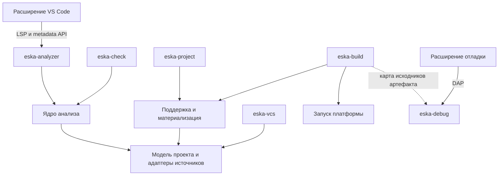

# Границы инструментов ESKA

Целевая архитектура экспериментального направления от 2026-10-08. Формат
проекта, анализ кода, сборка, Git и отладка имеют разные владельцы. Общее
понимание проекта переиспользуется через библиотеки; самостоятельные инструменты
отвечают за свои операции и жизненный цикл.

Имена бинарников ниже рабочие. Документ определяет границы будущей реализации;
сейчас эти функции ещё не выделены из существующего ESKA. Последовательность
работы находится в [плане экспериментов](roadmap/15-eska-format-experiments.md).

## Инструменты и назначение

| Инструмент | Ответственность | Интерфейс | Граница |
|---|---|---|---|
| `eska-project` | Создание проекта, импорт/экспорт исходного формата, структурная проверка, принятая база и политика поддержки | Одноразовые команды, human/JSON | Работает без платформы 1С, Git и сервера анализа; импорт здесь означает Designer XML ↔ ESKA |
| `eska-analyzer` | Постоянный сервер для IDE: метаданные, BSL/SDBL, навигация, диагностика, поиск, свойства и планы правок | LSP и расширения ESKA поверх одного соединения | Не собирает проект, не управляет Git и не подключается к рабочей ИБ |
| `eska-check` | Пакетный статический анализ для CI и локальной проверки | Одноразовый запуск, exit codes, JSON; формат отчёта согласуется отдельно | Использует то же ядро анализа, работает без IDE-сервера, Git, отладчика и платформы |
| `eska-build` | Нативные артефакты, распаковка CF/CFE/EPF/ERF и проверки установленной платформой | Одноразовые команды и структурированные результаты | Владеет runner, версиями платформы и временными ИБ; использует защищённый экспорт |
| `eska-vcs` | Ветки задач, status/diff/save, полки и другие разрешённые Git-операции | CLI; отдельный API только при появлении потребителя | Использует gix и проектную модель; не требует сервера анализа или платформы |
| `eska-debug` | Отладочная сессия 1С: подключение, breakpoints, шаги, стек и переменные | DAP | Собственный процесс на сессию; не пересобирает проект при отладочных запросах |

Для CI достаточно установленных `eska-check` и/или `eska-build` под конкретный
pipeline. Проверка кода и сборка имеют независимые зависимости. Универсальный
долгоживущий процесс CI не нужен. Небольшой пакетный инструмент всё равно содержит
необходимое ядро своей задачи: уменьшение размера проверяется сборкой и замерами.

Текущее имя `eska` может сохраняться как совместимый пользовательский вход,
делегирующий операции специализированным инструментам. Прямой запуск каждого
инструмента остаётся полноценным. Такая оболочка не владеет отдельной моделью,
индексом или бизнес-правилами.

## Общие библиотеки и направление зависимостей

На этапе выделения библиотек принимаются следующие области ответственности.
Это границы модулей и допустимых зависимостей, а не требование немедленно создать
отдельный crate для каждой структуры.

| Область | Что принадлежит ей | Кто использует |
|---|---|---|
| Модель и исходный формат проекта | Manifest, состав, native identity, типы метаданных, source locations, чтение XML/YAML, сохранение неизвестного, планы изменений | Все инструменты, которым нужен проект |
| Поддержка и материализация | Принятые байты, правила поставщика и ESKA, проверка разрешений, восстановление запрещённых частей, проверенный XML и карта происхождения | `eska-project`, `eska-build`; IDE получает разрешения и диагностику из тех же правил |
| Анализ | Синтаксис BSL/SDBL, разрешение имён, типы, зависимости, диагностика, поиск и семантические правки | `eska-analyzer`, `eska-check` |
| Запуск платформы | Обнаружение и проверка версии 1С, запуск процессов, отмена, диагностика и временные ресурсы | `eska-build`; отладчик может использовать небольшую общую часть поиска/запуска |
| VCS | Git-состояние, workflow и операции; смысловой diff как проекция двух снимков | `eska-vcs` |

Показаны основные зависимости. Сплошные стрелки от инструментов к библиотекам
обозначают зависимости в коде,
а не сетевые вызовы. LSP/DAP — границы процессов. Карта исходников — результат
сборки, который можно читать без работающего сборщика.

Общая модель не содержит LSP/DAP DTO, VS Code API, Git repository или Salsa DB.
Обратимая модель исходного документа сохраняет больше информации, чем проекция
для анализатора. Анализатор получает типизированные факты и места их объявления;
ему не нужно знать, в каком XML-элементе или YAML-ключе они хранятся.

Парсинг, разрешение ссылок метаданных и правила поддержки имеют один источник
реализации. При необходимости смыслового BSL-diff VCS может использовать
синтаксическую библиотеку; это не требует полного графа анализа и IDE runtime.
Циклические зависимости между верхними инструментами запрещены.

## Один сервер для дерева и языка в IDE

Основное расширение VS Code подключается к одному `eska-analyzer` на сеанс
рабочей области. Сервер обслуживает выбранные проекты; отдельный процесс на
объект или YAML-файл не создаётся. Первая версия не требует глобального демона,
общего для всех окон редактора.

Внутри сервера согласованы входные тексты, модель проекта и индексы. Изменение
несохранённого `object.yaml` должно быть видно дереву и анализу BSL в одной
ревизии. Открытые документы поступают от редактора, остальные — через слой
загрузки файлов. Событие файлового watcher не перезаписывает более свежий текст
открытого документа. Ответ для устаревшей ревизии отменяется или отбрасывается.

В [LSP](https://microsoft.github.io/language-server-protocol/overviews/lsp/overview/)
уже определены синхронизация открытых текстов и языковые операции. Для дерева,
свойств, состояния поддержки и карты исходников используются версионированные
расширения, например `eska/metadata/*`. Их точные методы проектируются отдельно.
Дерево конфигурации не подменяется списком символов одного текстового документа.

VS Code предоставляет [TreeDataProvider](https://code.visualstudio.com/api/extension-guides/tree-view).
Расширение запрашивает нужные дочерние узлы, преобразует их в TreeItem, хранит
раскрытие и выделение, показывает свойства и пользовательские команды. Состав,
идентичность объектов, разрешения и допустимость операций определяет сервер.
Кеш отображения в расширении не становится второй семантической моделью.

Ядро возвращает план редактирования с исходной ревизией. IDE применяет изменения
через согласованный механизм редактирования документов с проверкой версий;
CLI применяет тот же план через файловый writer с проверкой ожидаемых байтов.
Права проверяются общей логикой, а защищённый экспорт повторяет окончательную
проверку. Нельзя молча перезаписать несохранённый документ из фонового процесса.

## Анализатор и применимость референсов

Собственный формат требует собственного адаптера проекта и метаданных.
Язык BSL при этом не меняется. Отдельный продукт `eska-analyzer` может использовать
существующее языковое ядро; написание нового lexer/parser/type inference
не является обязательным следствием перехода на YAML.

Из [архитектуры rust-analyzer](https://rust-analyzer.github.io/book/contributing/architecture.html)
берём разделение входного состояния, вычисляемой модели и протокольного слоя:
запросы по неизменяемому снимку, инкрементальность, отмену и работу по запросу.
I/O и изменения входов контролирует host; семантические вычисления не читают
произвольное текущее состояние диска и не запускают Git или платформу.
Способ кеширования и конкретную версию движка выбираем по измерениям.

В проверенном `bsl-analyzer` на commit
`9021ba07471eee8a2614bed2105a2c8699f60780` уже есть
[общий AnalysisHost](https://github.com/1c-tooling/bsl-analyzer/blob/9021ba07471eee8a2614bed2105a2c8699f60780/crates/ide-host-core/src/lib.rs)
для нескольких интерфейсов. При этом
[metadata query](https://github.com/1c-tooling/bsl-analyzer/blob/9021ba07471eee8a2614bed2105a2c8699f60780/crates/ide-db/src/metadata.rs)
связана с разбором Designer XML, а верхний бинарник включает несколько подсистем.
Это полезный референс слоёв, но не готовая подключаемая реализация нового формата.

Первый выбор — проверить переиспользование подходящего ядра с адаптером
канонических метаданных. Если нужной границы нет, сравнить изменение upstream
и ограниченный fork. Проверка включает реальные API, транзитивные зависимости,
лицензии выбранных компонентов и стоимость обновления. Решение фиксируется
до переноса значительного объёма кода; автоматическая зависимость ESKA от всего
`bsl-analyzer-app` не вводится.

Экспорт XML при каждом нажатии клавиши не является целевым интерфейсом между
новым форматом и анализом. Проекция в XML допустима как отдельный переходный
эксперимент с явно измеренными ограничениями, особенно для несохранённых правок.

Для конфигураций с десятками тысяч файлов обязательны ленивая загрузка,
ограничения памяти, отмена и адресная инвалидация. Двоичные поставки, крупные
ресурсы и полная принятая база не загружаются в память анализатора целиком.
Ресурсные бюджеты проверяются на имеющихся больших стендах.

## Статическая проверка и проверка платформой

`eska-check` создаёт ограниченный по времени host того же ядра анализа,
проверяет выбранный сохранённый снимок и завершается. Одинаковые входы, профиль
платформы и настройки должны давать те же диагностики, что IDE после сохранения.
Полнота пакетного анализа задаётся явно; быстрый IDE-проход может иметь меньший
охват, и это не выдаётся за отсутствие проблем во всём проекте.

Проверка установленной платформой принадлежит `eska-build`. Её входы содержат
точную версию платформы, состав конфигурации и расширений, происхождение модуля
и проверяемый снимок. Исходники проекта и состояние применённой ИБ различаются.
Workspace members не считаются автоматически составом одной ИБ.

Статический анализ не вызывает платформенную проверку для обычного hover или
completion. CI и явная команда редактора могут запускать её отдельной операцией.
`eska-build` не вызывает `eska-check` как скрытый обязательный этап, а
`eska-check` не вызывает сборщик: порядок задаёт внешний pipeline.
Неподдержанный контекст, неполная проверка и ошибка окружения имеют отдельные
результаты и никогда не обозначаются как полная успешная проверка.

## Поддержка и владение записью

Источник разрешений — закреплённые нативные сведения и принятая политика ESKA.
Один и тот же evaluator обслуживает IDE, проектные операции и экспорт.
Режим read-only редактора и показанные в YAML статусы не заменяют эти сведения.

Публичная материализация для `eska-project` и `eska-build` всегда проходит
восстановление запрещённых частей и проверку итогового состава. Низкоуровневый
XML writer не предлагается пользователю как обход этого этапа. При удалении
кеша база восстанавливается из закреплённого источника либо операция завершается
ошибкой. Экспорт не меняет рабочие исходники.

VCS сохраняет рабочие файлы такими, какими они есть. Наличие запрещённой правки
в commit не делает её допустимой при экспорте. Нельзя связывать корректность
результата с обязательным использованием конкретного Git-клиента.

IDE-снимок может включать несохранённые документы. Пакетный экспорт и сборка
используют отдельный зафиксированный снимок сохранённых входов; они не читают
память IDE. Если понадобится сборка несохранённого состояния, она получает
явно переданный снимок как отдельную возможность. Каждый результат указывает
проверенную ревизию и профиль, чтобы состояния нельзя было перепутать.

## Отладчик и карта исходников

[DAP](https://microsoft.github.io/debug-adapter-protocol/overview) задаёт отдельную
границу между редактором и адаптером отладчика. Расширение отладки владеет
launch/attach UI и настройками сессии, `eska-debug` — протоколом платформы,
состоянием выполнения и сопоставлением исходников. Сервер анализа для работы
отладчика не обязателен.

Результат сборки должен содержать согласованную карту: project/object/module
identity, URI источника, fingerprint фактически собранного текста, платформенный
адрес модуля и при необходимости преобразование координат. Версии формата,
правил экспорта и состав расширений входят в контекст карты.

Если защита восстановила прежний BSL из базы, рабочий файл может отличаться от
собранного модуля. Отладчик проверяет соответствие и показывает правильную
версию либо диагностирует несовпадение. Он не считает текущий текст редактора
автоматически текстом работающей ИБ. Проверка доступности сведений о реально
загруженной конфигурации — часть будущего протокола с платформой.

## Расширения и поставка

Основное расширение ESKA объединяет дерево и языковые возможности через один
backend. Отладка поставляется отдельно. Для VCS сначала пригодны CLI и обычные
механизмы VS Code; самостоятельное расширение нужно при конкретном собственном
workflow, а не только из-за отдельного бинарника.

Для одного документа в выбранном режиме должен быть понятный владелец языковых
возможностей. Переход с существующего BSL-сервера проверяется на уровне workspace;
два полных провайдера не должны одновременно выдавать дубли диагностики и правок.
Глобальное отключение сторонних расширений не является частью миграции проекта.

Первые библиотеки и бинарники можно вести в одном Rust workspace и выпускать
согласованным набором версий. Самостоятельная установка не требует отдельного
репозитория. Crates выделяются при появлении конкретных потребителей, начиная
с модели проекта и двух потребителей анализа. Независимые release cycles можно
ввести после появления потребности и проверенной совместимости.

Каждый бинарник имеет явный список зависимостей. `eska-check` не подтягивает
LSP runtime, Git transport или debugger; `eska-build` не включает ядро BSL-анализа;
`eska-vcs` не зависит от платформы. Это проверяется транзитивным графом и размером
пакетов. Разделение одними флагами запуска внутри прежнего тяжёлого бинарника
само по себе этих границ не обеспечивает.

## Переход от текущего состояния

Сейчас [модель проекта](../src/project/model.rs) поддерживает Designer XML,
а [IDE protocol 1.x](ide-protocol.md) обслуживается командой `eska ide --stdio`.
Это собственный JSON-RPC API с framing, похожим на LSP, но не реализация LSP.
Explorer уже использует backend для состава дерева и свойств.

Сначала выделяются общие проектные операции с сохранением поведения XML и
проверяются входы нового формата. Затем выбирается основа анализа, выделяются
IDE- и пакетная точки входа и подключается клиент. VCS и нативные операции
отделяются по своим зависимостям. Начать эксперимент с YAML можно до полного
разделения всех существующих команд, соблюдая эти границы в новом коде.

Переход на LSP с metadata-расширениями требует отдельной версии протокола,
согласованного клиента, capabilities, координат, отмены и синхронизации текстов.
Переименование исполняемого файла не превращает действующий handshake в LSP.
Документированные текущие CLI/JSON-контракты сохраняются до явного плана миграции.
Структуры памяти движка и AST не становятся публичным межпроцессным API.

Приёмка архитектуры включает пять независимых сценариев: дерево без платформы
и тяжёлого BSL-прохода; анализ несохранённых YAML/BSL в одной ревизии; пакетная
проверка без IDE; сборка без BSL-сервера и Git; VCS без платформы и анализатора.
Отладка добавляет собственный сценарий с проверенной картой собранных исходников.
