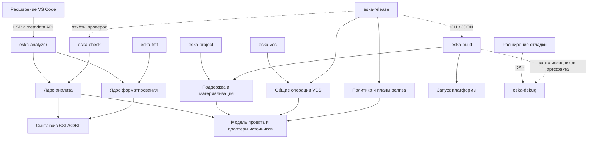

# Границы инструментов ESKA

Целевая архитектура экспериментального направления от 2026-10-08. Формат
проекта, анализ кода, форматирование, сборка, Git, релизы и отладка имеют разных
владельцев. Общее понимание проекта переиспользуется через библиотеки;
самостоятельные инструменты отвечают за свои операции и жизненный цикл.

Документ определяет целевые границы. Самостоятельный
[eska-project](research/eska-format/project-cli.md) и
[eska-build](research/eska-format/build-cli.md),
[eska-check с профилем syntax](research/eska-format/check-cli.md) и
[eska-analyzer для чтения метаданных](research/eska-format/analyzer-metadata.md)
и [синхронизации черновиков YAML/BSL](research/eska-format/analyzer-documents.md)
с [pull-диагностикой syntax](research/eska-format/analyzer-diagnostics.md),
[отменой активного запроса](research/eska-format/analyzer-cancellation.md)
и [общим таймером server/checker](research/eska-format/analyzer-deadline.md)
доступны в экспериментальной сборке. Полный IDE-сервер, остальные точки входа
и комплектная поставка ещё предстоят.
Последовательность работы и ссылки на связанные задачи находятся в
[плане экспериментов](roadmap/15-eska-format-experiments.md).

## Инструменты и назначение

| Инструмент | Ответственность | Интерфейс | Граница |
|---|---|---|---|
| `eska-project` | Создание проекта, импорт/экспорт исходного формата, структурная проверка, принятая база и политика поддержки | Одноразовые команды, human/JSON | Работает без платформы 1С, Git и сервера анализа; импорт здесь означает Designer XML ↔ ESKA |
| `eska-analyzer` | Постоянный сервер для IDE: метаданные, BSL/SDBL, навигация, диагностика, поиск, свойства и планы правок | LSP и расширения ESKA поверх одного соединения | Не собирает проект, не управляет Git и не подключается к рабочей ИБ |
| `eska-check` | Пакетный статический анализ для CI и локальной проверки | Одноразовый запуск, exit codes, JSON; формат отчёта согласуется отдельно | Использует то же ядро анализа, работает без IDE-сервера, Git, отладчика и платформы |
| `eska-fmt` | Настраиваемое оформление BSL, позднее SDBL и выбранных документов ESKA | CLI для файла, диапазона, stdin и проекта; check/diff/write | Использует библиотеку форматирования без семантического индекса, LSP runtime, Git и платформы |
| `eska-build` | Нативные артефакты, распаковка CF/CFE/EPF/ERF и проверки установленной платформой | Одноразовые команды и структурированные результаты | Владеет runner, версиями платформы и временными ИБ; использует защищённый экспорт |
| `eska-vcs` | Ветки задач, status/diff/save, полки и другие разрешённые Git-операции | CLI; отдельный API только при появлении потребителя | Использует gix и проектную модель; не требует сервера анализа или платформы |
| `eska-release` | План версии и changelog, Release PR/MR, выпуск и публикация поставки проекта 1С | Одноразовые команды, dry-run, human/JSON; adapters GitHub/GitLab | Организует релиз через общие VCS-операции и результаты check/build; не реализует их движки и не обновляет рабочие ИБ |
| `eska-debug` | Отладочная сессия 1С: подключение, breakpoints, шаги, стек и переменные | DAP | Собственный процесс на сессию; не пересобирает проект при отладочных запросах |

Для CI устанавливаются `eska-fmt`, `eska-check` и/или `eska-build` под конкретный
pipeline, а для выпуска — `eska-release`. Форматирование, проверка кода и сборка
имеют независимые зависимости. Универсальный долгоживущий процесс CI не нужен.
Небольшой пакетный инструмент всё равно содержит необходимое ядро своей задачи:
уменьшение размера проверяется сборкой и замерами.

Текущее имя `eska` может сохраняться как совместимый пользовательский вход,
делегирующий операции специализированным инструментам. Прямой запуск каждого
инструмента остаётся полноценным. Такая оболочка не владеет отдельной моделью,
индексом или бизнес-правилами.

Принято: обычная установка `eska` поставляет комплект готовых основных
инструментов согласованных версий и эту небольшую оболочку. Полный комплект
содержит отдельные исполняемые файлы. Для CI и IDE доступны самостоятельные
пакеты, которым оболочка не нужна; общие библиотеки входят в сборку каждого
потребителя. Отладчик остаётся отдельным дополнением.

## Общие библиотеки и направление зависимостей

На этапе выделения библиотек принимаются следующие области ответственности.
Это границы модулей и допустимых зависимостей, а не требование немедленно создать
отдельный crate для каждой структуры.

| Область | Что принадлежит ей | Кто использует |
|---|---|---|
| Модель и исходный формат проекта | Manifest, состав, native identity, типы метаданных, source locations, чтение XML/YAML, сохранение неизвестного, планы изменений | Все инструменты, которым нужен проект |
| Поддержка и материализация | Принятые байты, правила поставщика и ESKA, проверка разрешений, восстановление запрещённых частей, проверенный XML и карта происхождения | `eska-project`, `eska-build`; IDE получает разрешения и диагностику из тех же правил |
| Синтаксис | Lexer/parser и дерево с сохранением исходных токенов и комментариев | Анализ, форматирование, при необходимости смысловой diff |
| Анализ | Разрешение имён, типы, зависимости, диагностика, поиск и семантические правки | `eska-analyzer`, `eska-check` |
| Форматирование | Типизированный стиль, правила раскладки, расчёт текстовых правок; общий resolver настроек отделён от вычислений | `eska-fmt` и `eska-analyzer` как два потребителя одной библиотеки |
| Запуск платформы | Обнаружение и проверка версии 1С, запуск процессов, отмена, диагностика и временные ресурсы | `eska-build`; отладчик может использовать небольшую общую часть поиска/запуска |
| VCS | Git-состояние, workflow и операции; смысловой diff как проекция двух снимков | `eska-vcs`; `eska-release` использует нужные операции и чтение истории |
| Релиз | Политика версии, выбор изменений, план changelog и выпуска; provider adapters и выполнение отделены от расчёта | `eska-release`; прежний CLI может делегировать версионирование без второй реализации |



Показаны основные зависимости. Сплошные стрелки от инструментов к библиотекам
обозначают зависимости в коде. Подписанные LSP/DAP и CLI/JSON обозначают границы
процессов; отчёты проверок могут поступать из CI. Карта исходников — результат
сборки, который можно читать без работающего сборщика.

Общая модель не содержит LSP/DAP DTO, VS Code API, Git repository или Salsa DB.
Обратимая модель исходного документа сохраняет больше информации, чем проекция
для анализатора. Анализатор получает типизированные факты и места их объявления;
ему не нужно знать, в каком XML-элементе или YAML-ключе они хранятся.

Парсинг, разрешение ссылок метаданных и правила поддержки имеют один источник
реализации. При необходимости смыслового BSL-diff VCS может использовать
синтаксическую библиотеку; это не требует полного графа анализа и IDE runtime.
Циклические зависимости между верхними инструментами запрещены.

## Один сервер для дерева и языка в IDE

Основное расширение VS Code подключается к одному `eska-analyzer` на сеанс
рабочей области. Сервер обслуживает выбранные проекты; отдельный процесс на
объект или YAML-файл не создаётся. Первая версия не требует глобального демона,
общего для всех окон редактора.

Внутри сервера согласованы входные тексты, модель проекта и индексы. Изменение
несохранённого `object.yaml` должно быть видно дереву и анализу BSL в одной
ревизии. Открытые документы поступают от редактора, остальные — через слой
загрузки файлов. Событие файлового watcher не перезаписывает более свежий текст
открытого документа. Ответ для устаревшей ревизии отменяется или отбрасывается.

В [LSP](https://microsoft.github.io/language-server-protocol/overviews/lsp/overview/)
уже определены синхронизация открытых текстов и языковые операции. Для дерева,
свойств, состояния поддержки и карты исходников используются версионированные
расширения, например `eska/metadata/*`. Их точные методы проектируются отдельно.
Дерево конфигурации не подменяется списком символов одного текстового документа.

[Hover символа](research/eska-format/analyzer-symbol-hover.md) получает typed
карточку из общего ядра. IDE transport владеет локализованными заголовками,
negotiation plaintext/markdown и оформлением authored text. Языковой core не
содержит собственных UI-заголовков и не отправляет native XML/graph locations.

[SignatureHelp](research/eska-format/analyzer-call-signatures.md) получает
сигнатуры и выбор аргумента из того же native call binding, что inference.
IDE transport согласует формат документации, UTF-16 labels и nullable selection;
прежняя карточка клиента не становится вторым источником семантики.

[References](research/eska-format/analyzer-references.md) получает поиск и kind
из native resolver общего ядра. IDE transport переводит подтверждённые текущие
диапазоны в Locations, сохраняя target hash, coverage и caps. Неполный поиск
не становится основанием для rename; второй текстовый индекс не создаётся.

[Локальный rename](research/eska-format/analyzer-local-rename.md) получает native
method scope и occurrences из общего ядра; модель проекта определяет pinned
module permission тем же resolver, что защищённый экспорт. IDE transport
возвращает один versioned WorkspaceEdit с UTF-16 ranges. Применение остаётся
за клиентом; server не записывает BSL и не выдаёт частичный поиск за полный план.

VS Code предоставляет [TreeDataProvider](https://code.visualstudio.com/api/extension-guides/tree-view).
Расширение запрашивает нужные дочерние узлы, преобразует их в TreeItem, хранит
раскрытие и выделение, показывает свойства и пользовательские команды. Состав,
идентичность объектов, разрешения и допустимость операций определяет сервер.
Кеш отображения в расширении не становится второй семантической моделью.

В текущем экспериментальном сервере [события состава и настроек](research/eska-format/analyzer-project-changes.md)
завершают прежний host с `eska/restartRequired`. Клиент отбрасывает результаты
старого snapshot, запускает новый процесс и повторно передаёт открытые документы.
Сервер сообщает точные control URI и [запрашивает динамическую подписку](research/eska-format/analyzer-watcher-registration.md)
у поддерживающего клиента. Подписка ограничена control files; watcher всех
saved inputs и автоматический restart клиента пока не подключены.
Эти обязанности не переходят в проектный или сборочный CLI.

Ядро возвращает план редактирования с исходной ревизией. IDE применяет изменения
через согласованный механизм редактирования документов с проверкой версий;
CLI применяет тот же план через файловый writer с проверкой ожидаемых байтов.
Права проверяются общей логикой, а защищённый экспорт повторяет окончательную
проверку. Нельзя молча перезаписать несохранённый документ из фонового процесса.

## Анализатор и применимость референсов

Собственный формат требует собственного адаптера проекта и метаданных.
Язык BSL при этом не меняется. Отдельный продукт `eska-analyzer` может использовать
существующее языковое ядро; написание нового lexer/parser/type inference
не является обязательным следствием перехода на YAML.

Из [архитектуры rust-analyzer](https://rust-analyzer.github.io/book/contributing/architecture.html)
берём разделение входного состояния, вычисляемой модели и протокольного слоя:
запросы по неизменяемому снимку, инкрементальность, отмену и работу по запросу.
I/O и изменения входов контролирует host; семантические вычисления не читают
произвольное текущее состояние диска и не запускают Git или платформу.
Способ кеширования и конкретную версию движка выбираем по измерениям.

В проверенном `bsl-analyzer` на commit
`9021ba07471eee8a2614bed2105a2c8699f60780` уже есть
[общий AnalysisHost](https://github.com/1c-tooling/bsl-analyzer/blob/9021ba07471eee8a2614bed2105a2c8699f60780/crates/ide-host-core/src/lib.rs)
для нескольких интерфейсов. При этом
[metadata query](https://github.com/1c-tooling/bsl-analyzer/blob/9021ba07471eee8a2614bed2105a2c8699f60780/crates/ide-db/src/metadata.rs)
связана с разбором Designer XML, а верхний бинарник включает несколько подсистем.
Это полезный референс слоёв, но не готовая подключаемая реализация нового формата.

[EF-17](research/eska-format/analysis-kernel.md) выбрала `ide-host-core` с адаптером
канонических метаданных. Неизменяемые контексты уже проверены; для постоянного
host нужно адресное расширение входного API в EF-18. Отдельный fork всего ядра
не выбран. Состав зависимостей, лицензии и стоимость обновления закреплены
в результате эксперимента; весь `bsl-analyzer-app` в ESKA не встраивается.

Экспорт XML при каждом нажатии клавиши не является целевым интерфейсом между
новым форматом и анализом. Проекция в XML допустима как отдельный переходный
эксперимент с явно измеренными ограничениями, особенно для несохранённых правок.

Для конфигураций с десятками тысяч файлов обязательны ленивая загрузка,
ограничения памяти, отмена и адресная инвалидация. Двоичные поставки, крупные
ресурсы и полная принятая база не загружаются в память анализатора целиком.
Ресурсные бюджеты проверяются на имеющихся больших стендах.

## Статическая проверка и проверка платформой

`eska-check` создаёт ограниченный по времени host того же ядра анализа,
проверяет выбранный сохранённый снимок и завершается. Одинаковые входы, профиль
платформы и настройки должны давать те же диагностики, что IDE после сохранения.
Полнота пакетного анализа задаётся явно; быстрый IDE-проход может иметь меньший
охват, и это не выдаётся за отсутствие проблем во всём проекте.

Проверка установленной платформой принадлежит `eska-build`. Её входы содержат
точную версию платформы, состав конфигурации и расширений, происхождение модуля
и проверяемый снимок. Исходники проекта и состояние применённой ИБ различаются.
Workspace members не считаются автоматически составом одной ИБ.

Статический анализ не вызывает платформенную проверку для обычного hover или
completion. CI и явная команда редактора могут запускать её отдельной операцией.
`eska-build` не вызывает `eska-check` как скрытый обязательный этап, а
`eska-check` не вызывает сборщик: порядок задаёт внешний pipeline.
Неподдержанный контекст, неполная проверка и ошибка окружения имеют отдельные
результаты и никогда не обозначаются как полная успешная проверка.

Проверку оформления выполняет `eska-fmt` в режиме без записи. Правила Git
проверяет `eska-vcs`. `eska-check` не становится агрегатором этих инструментов:
общий отчёт собирается снаружи по их структурированным результатам.

## Настраиваемый форматтер

Для `eska-fmt` берём из [clang-format](https://clang.llvm.org/docs/ClangFormatStyleOptions.html)
модель стиля: конфигурацию в репозитории, presets, явное наследование и локальные
переопределения. [LibFormat](https://clang.llvm.org/docs/LibFormat.html) также
служит референсом библиотеки, возвращающей правки для заданных диапазонов.
Грамматика и правила BSL требуют собственной реализации; совместимость со всеми
опциями `.clang-format` не обещается.

Библиотека принимает текст или его синтаксическое дерево, эффективный стиль,
языковой профиль и диапазон. Возвращает правки и структурированные причины
отказа. Она не читает файлы, не пишет в них и не требует метаданных конфигурации
или полного анализа типов. Слой раскладки отделяет синтаксические ограничения
от выбора пробелов и переносов; добавление настройки не превращается в набор
независимых замен регулярными выражениями.

CLI загружает входы и настройки, выбирает файлы/объекты и применяет правки.
`eska-analyzer` вызывает ту же библиотеку для LSP formatting/rangeFormatting
по текущему тексту редактора. Второй процесс форматтера и отдельное расширение
для основного сценария VS Code не нужны. Вызов из IDE учитывает версию документа;
пакетная запись проверяет, что исходные байты не изменились после расчёта.

Предлагаемый контракт настроек, который предстоит утвердить в T26:

- отдельный файл `.eska-format` в YAML, пригодный и для BSL без manifest проекта;
  версии схемы и набора правил стиля, зафиксированная версия инструмента в CI;
- именованные presets с переопределением отдельных свойств; поиск от пути файла
  до корня проекта или явно заданной границы, наследование родителей только явно;
- приоритет: preset → унаследованные настройки → ближайший файл настроек →
  языковые/путевые переопределения → явные параметры вызова; порядок совпадающих
  путевых правил фиксируется схемой, для stdin задаётся исходное имя файла;
- отступы и продолжения, пробелы, длина строки, переносы аргументов/выражений,
  выравнивание, пустые строки и оформление комментариев; ограничения синтаксиса
  имеют приоритет над желаемой шириной, длинный литерал не разрезается;
- исключённые пути, локальные участки format off/on и вывод эффективной
  конфигурации с происхождением значений. Неизвестная опция или версия — ошибка.

Настройки редактора служат fallback при отсутствии проектной конфигурации.
При наличии конфигурации IDE и CLI получают один стиль, включая отступы.
Пользовательский machine config не меняет результат CI скрыто. Один и тот же
текст, диапазон, версия движка и эффективный стиль дают одинаковые правки.

Первая поставка форматирует BSL. Она сохраняет значения строк, комментарии,
директивы и порядок инструкций; BOM и окончания строк сохраняются по умолчанию,
нормализация возможна только явно. Повторный запуск не меняет результат.
Переименование, исправление диагностик и перестановка методов относятся к
рефакторингам. Неизвестная или повреждённая конструкция не переписывается;
частичная обработка имеет явный результат и не считается полной проверкой.

SDBL выделяется в отдельный языковой профиль. Форматирование самостоятельного
запроса не даёт разрешения менять произвольную строку BSL: её текст может быть
наблюдаемым значением. Встроенные запросы требуют отдельного opt-in, распознавания
контекста и обратимой карты диапазонов; динамически собранные строки сохраняются.

Оформление YAML ESKA — дополнительный этап после стабилизации схемы. Его правила
не меняют identity, состав, значимый порядок, scalar values и неизвестные данные.
Канонический экспорт XML принадлежит `eska-project` и не зависит от выбранного
стиля исходников. Разбор документа и сохранение комментариев переиспользуются
из проектного слоя; serializer экспорта не используется как форматтер редактора.

При работе с проектом host проверяет общие разрешения записи. Защищённый модуль
не переписывается; исключение, отказ и неполная проверка видны в отчёте.
Само ядро форматирования не решает, кому принадлежит исходник. Проверка
отдельного текста не выдаёт разрешение на его запись или последующий экспорт.

В проверенном bsl-analyzer на commit `9021ba07471eee8a2614bed2105a2c8699f60780`
[FormattingConfig](https://github.com/1c-tooling/bsl-analyzer/blob/9021ba07471eee8a2614bed2105a2c8699f60780/crates/ide/src/formatting/config.rs)
уже содержит ряд правил пробелов и отступов. Это кандидат для оценки, а не
готовый контракт гибкого стиля ESKA. T26 отдельно проверяет возможность
переиспользовать синтаксис и formatter без зависимости от всего IDE-продукта.

## Автоматизация релизов проекта 1С

`eska-release` — отдельный продукт для выпуска конфигураций, расширений,
обработок и отчётов. Референс [release-plz](https://release-plz.dev/docs/usage)
разделяет локальную подготовку, Release PR и публикацию. Для ESKA принимаем
тот же двухэтапный процесс: проверяемые изменения версии/changelog в PR/MR,
затем выпуск выбранного commit после слияния. Cargo registry и проверка Rust API
не переносятся в контракт проекта 1С.

Расчёт принимает историю, предыдущий релиз, состав workspace и явную политику.
Возвращает воспроизводимый план: выбранные проекты, причину bump, старые/новые
версии, изменения changelog и ожидаемые артефакты. Библиотека расчёта не вызывает
сеть, платформу или Git самостоятельно. Host получает историю через общий
VCS-слой; чтение и точечная запись версии принадлежат общему проектному слою.

В целевой модели обязательны две схемы версии:

| Схема | Исходная версия | patch | minor | major |
|---|---|---|---|---|
| Три компонента `x.y.z` | `2.4.6` | `2.4.7` | `2.5.0` | `3.0.0` |
| Четыре компонента `x.y.z.build`, существующая семантика T25 | `2.4.6.8` | `2.4.7.1` | `2.5.1.1` | `3.0.1.1` |

Трёхкомпонентная схема использует числовое ядро
[SemVer](https://semver.org/spec/v2.0.0.html): нули в начале числовых компонентов
не допускаются. Это не обещание автоматической проверки совместимости 1С.
Для четырёх компонентов сохраняются прежние сбросы и ширина чисел T25;
четвёртое число не подменяется SemVer build metadata после `+`.
Prerelease и дополнительные суффиксы требуют отдельной спецификации.

Схема настраивается для проекта, с default workspace и переопределением member.
При отсутствии настройки сохраняется схема существующей корректной строки;
для первого релиза начальная версия задаётся явно. Несоответствие настройке —
ошибка, смена схемы — отдельная явная миграция. `1.2.3` не становится `1.2.3.0`.
Ручной bump, автоматический план, исходники, tag и паспорт артефакта используют
один тип версии с явной схемой. Текущий parser T25 принимает только четыре
компонента; расширение модели и публичных контрактов выделено в T83.

Место хранения определяется типом проекта. Для конфигурации/расширения это
свойство версии корневого объекта. Для внешнего отчёта/обработки — обязательная
функция `Версия()` без параметров в модуле объекта, возвращающая один строковый
литерал выбранной схемы. Она неэкспортная: `СведенияОВнешнейОбработке()` вызывает
её из того же модуля и помещает результат в поле `Версия` возвращаемой структуры.
Утилита читает и меняет исходник, без исполнения BSL. Пример целевого контракта:

```bsl
// Возвращает версию внешней обработки или отчёта.
//
// Возвращаемое значение:
//  Строка - версия проекта в выбранной схеме.
Функция Версия()
    Возврат "1.2.3";
КонецФункции
```

У внешнего объекта литерал в `Версия()` — единственный изменяемый источник
номера. Настройки хранят схему; сведения регистрации и паспорт получают номер
из этого источника. Если модель ESKA показывает отдельное поле версии, для этих
типов оно является проекцией функции. Добавление выдуманного `Properties/Version`
в XML внешнего объекта не используется как способ хранения.

T84 добавляет функцию при создании исходников внешнего объекта и отдельный план
миграции существующего проекта. Пустой каркас без модуля ещё не считается готовым
внешним объектом. Импорт и открытие сохраняют исходники; отсутствие функции
диагностируется, а исправление предлагается отдельной правкой. Чтение проекта
возможно до исправления, сборка/публикация по новому контракту требуют функцию.
При использовании регистрации БСП поле версии в `СведенияОВнешнейОбработке()`
получает вызов `Версия()`; сама функция регистрации не генерируется с выдуманным
составом команд, назначений или требованиями БСП.

Ручной bump и подготовка релиза обновляют только литерал через общий
синтаксический редактор проекта. Автоматические изменения не зависят от
пользовательского стиля форматтера. Существующая произвольная логика, дубли,
параметры или условные определения функции требуют диагностики и явной миграции;
она не переписывается целиком. BOM, CRLF, комментарии и остальной модуль
сохраняются. Простая экспортная функция с подходящим телом мигрируется в
неэкспортную только после проверки внешних обращений, а не молчаливым удалением
`Экспорт`. Проверка проекта и выпуск используют один контракт версии.

Conventional Commits выбирают bump по настраиваемым правилам; решение о
совместимости остаётся политикой проекта. Версии members независимы; общие пути,
зависимости и синхронные release groups задаются явно. Workspace не означает
автоматически одну поставку или одну ИБ. Схема тега — `v<version>` для одного
проекта и `<project.name>/v<version>` для members; обе длины версии допустимы.

Предлагаются три фазы с отдельными результатами, имена команд предварительные:

1. `plan` — расчёт без записи и сетевых изменений, фиксирующий baseline, commit
   и fingerprint политики. Подготовленная ранее версия не повышается повторно
   на том же наборе изменений. T56 предоставляет этот расчёт и локальное
   применение изменения версии через запланированный `eska version bump auto`.
2. `prepare` — применение согласованного плана версии/changelog и подготовка
   Release PR/MR через adapter GitHub или GitLab. Diff минимален; форматирование
   всех исходников не входит в подготовку релиза. Изменившиеся входы требуют
   нового плана. Чужие правки в release branch не перезаписываются автоматически.
3. `publish` — после слияния фиксируется новый план публикации с точным release
   commit. Проверки, защищённая материализация и сборка относятся к этому commit,
   не к текущему HEAD, который мог уйти вперёд. После успешных обязательных
   проверок tag указывает на этот commit, публикуются артефакты и паспорт.

План подготовки и план публикации различаются: будущий SHA merge/squash commit
нельзя закрепить заранее в Release PR. После слияния сверяются подготовленная
версия и состав релиза; новый commit и его результаты становятся неизменяемыми
входами публикации. Повтор не пересчитывает версию от новой вершины ветки.

`eska-release` использует общие VCS-операции без второго Git-движка.
Проверки и сборка выполняются специализированными инструментами через
версионированные результаты/CLI JSON либо поступают готовыми из CI с проверкой
происхождения. Их ядра не линкуются в release tool. Настройки, токены и API
провайдера принадлежат слою выполнения; версия и changelog рассчитываются
одинаково локально, в GitHub Actions и GitLab CI.

Паспорт связывает проект, схему/значение версии, release commit, состав поставки,
профиль платформы, версию инструментов, результаты обязательных проверок и hashes
артефактов. Если версия восстановилась защитой или артефакт собран из другого
снимка, публикация отклоняется. Изменение версии учитывает правила поддержки
наравне с другими свойствами; release tool не обходит защищённый экспорт.

Повтор запуска сверяет уже созданные tag/release/assets по тому же плану и
hashes. Совпадение — завершённый шаг, несовпадение — конфликт; существующий
релиз не заменяется молча. Частичный сбой позволяет продолжить публикацию
сохранённых артефактов, а не незаметно пересобрать их другими средствами.
Параллельные запуски одного релиза требуют координации и проверки коллизий.

Этапы идут через T83/T84 → T56 → T32; T33 оформляет тонкие CI adapters.
Возможности начинают с Designer XML и затем получают адаптер ESKA через EF-10
и приёмку соответствующих профилей; для внешних объектов требуется EF-14.
Готовность нового формата не является условием реализации release tool.
Версия бинарника ESKA и действующая release-plz automation этого Rust-репозитория
имеют отдельный жизненный цикл. Здесь они не изменяются.

## Поддержка и владение записью

Источник разрешений — закреплённые нативные сведения и принятая политика ESKA.
Один и тот же evaluator обслуживает IDE, проектные операции и экспорт.
Режим read-only редактора и показанные в YAML статусы не заменяют эти сведения.

Публичная материализация для `eska-project` и `eska-build` всегда проходит
восстановление запрещённых частей и проверку итогового состава. Низкоуровневый
XML writer не предлагается пользователю как обход этого этапа. При удалении
кеша база восстанавливается из закреплённого источника либо операция завершается
ошибкой. Экспорт не меняет рабочие исходники.

VCS сохраняет рабочие файлы такими, какими они есть. Наличие запрещённой правки
в commit не делает её допустимой при экспорте. Нельзя связывать корректность
результата с обязательным использованием конкретного Git-клиента.

IDE-снимок может включать несохранённые документы. Пакетный экспорт и сборка
используют отдельный зафиксированный снимок сохранённых входов; они не читают
память IDE. Если понадобится сборка несохранённого состояния, она получает
явно переданный снимок как отдельную возможность. Каждый результат указывает
проверенную ревизию и профиль, чтобы состояния нельзя было перепутать.

## Отладчик и карта исходников

[DAP](https://microsoft.github.io/debug-adapter-protocol/overview) задаёт отдельную
границу между редактором и адаптером отладчика. Расширение отладки владеет
launch/attach UI и настройками сессии, `eska-debug` — протоколом платформы,
состоянием выполнения и сопоставлением исходников. Сервер анализа для работы
отладчика не обязателен.

Результат сборки должен содержать согласованную карту: project/object/module
identity, URI источника, fingerprint фактически собранного текста, платформенный
адрес модуля и при необходимости преобразование координат. Версии формата,
правил экспорта и состав расширений входят в контекст карты.

Если защита восстановила прежний BSL из базы, рабочий файл может отличаться от
собранного модуля. Отладчик проверяет соответствие и показывает правильную
версию либо диагностирует несовпадение. Он не считает текущий текст редактора
автоматически текстом работающей ИБ. Проверка доступности сведений о реально
загруженной конфигурации — часть будущего протокола с платформой.

## Расширения и поставка

Основное расширение ESKA объединяет дерево и языковые возможности через один
backend. Отладка поставляется отдельно. Для VCS сначала пригодны CLI и обычные
механизмы VS Code; самостоятельное расширение нужно при конкретном собственном
workflow, а не только из-за отдельного бинарника.

Для одного документа в выбранном режиме должен быть понятный владелец языковых
возможностей. Переход с существующего BSL-сервера проверяется на уровне workspace;
два полных провайдера не должны одновременно выдавать дубли диагностики и правок.
Глобальное отключение сторонних расширений не является частью миграции проекта.

Принятые сценарии установки:

| Сценарий | Нужный состав |
|---|---|
| Рабочее место разработчика | `eska` и все готовые основные инструменты данного комплекта |
| CI со статическими проверками | `eska-check`, при проверке оформления также `eska-fmt` |
| CI со сборкой | `eska-build` и настроенная платформа 1С; IDE и полный анализ не обязательны |
| VS Code | `eska-analyzer`; форматирование подключается библиотекой, без отдельного `eska-fmt` |
| Планирование релиза | `eska-release` самостоятельно |
| Выпуск артефактов | `eska-release` и инструменты проверок/сборки из релизной политики либо проверенные готовые результаты CI |
| Отладка | Дополнительный `eska-debug` и его клиент |

Полнота комплекта описывает состав конкретного выпуска, а не готовность всех
пунктов roadmap. Первый пилот может содержать только уже принятые инструменты;
неподдержанные возможности явно обозначаются в capabilities и документации.
Обычная установка не требует вручную собирать этот комплект из отдельных пакетов.
Выборочная установка и её обновление сохраняют выбранный состав.

Оболочка проверяет наличие и совместимость инструментов до изменяющих действий,
передаёт аргументы, потоки и код завершения. Для создания из CF она координирует
распаковку сборщиком, создание/преобразование проектным инструментом и Git init
через VCS при выбранном workflow. Импорт CF не добавляется в offline-ядро
`eska-project`. При чтении ESKA производный XML не используется как запасной
источник. Сквозной CLI проверяется в EF-20, поставка и обновление — в EF-21,
форматирование/релизы нового источника — в EF-22.

Первые библиотеки и бинарники можно вести в одном Rust workspace и выпускать
согласованным набором версий. Самостоятельная установка не требует отдельного
репозитория. Crates выделяются при появлении конкретных потребителей, начиная
с модели проекта и двух потребителей анализа. Независимые release cycles можно
ввести после появления потребности и проверенной совместимости.

Каждый бинарник имеет явный список зависимостей. `eska-check` не подтягивает
LSP runtime, Git transport или debugger; `eska-build` не включает ядро BSL-анализа;
`eska-vcs` не зависит от платформы; `eska-fmt` обходится синтаксисом и правилами
стиля без полной базы анализа; `eska-release` не включает движки анализа,
форматирования и запуска платформы. Это проверяется транзитивным графом и размером
пакетов. Разделение одними флагами запуска внутри прежнего тяжёлого бинарника
само по себе этих границ не обеспечивает.

## Переход от текущего состояния

В экспериментальной ветке [модель проекта](../src/project_core/model.rs)
поддерживает Designer XML и [явные настройки ESKA](research/eska-format/project-selection.md).
Прежний CLI для XML возвращает явный отказ при выборе ESKA.
Самостоятельный `eska-project` использует общий core без платформы и Git;
`eska-build` собирает сохранённые входы через общую библиотеку без Git и анализатора.
Первый [самостоятельный `eska-check`](research/eska-format/check-cli.md) собирается
отдельно с `check-cli`, использует общую сессию анализа для явного профиля `syntax`
и возвращает неполноту метаданных. LSP runtime, Git, отладчик и платформа
не входят в его граф зависимостей; к комплектной установке он пока не подключён.
Отдельный [eska-analyzer](research/eska-format/analyzer-metadata.md) уже обслуживает
metadata, full-sync YAML/BSL, syntax pull, [completion](research/eska-format/analyzer-completion.md)
и [переход к текущему BSL-объявлению](research/eska-format/analyzer-definitions.md)
из того же host. Языковые запросы имеют общий control отмены и deadline;
неполнота чтения/моделей отделена от полной семантики.
[Структура BSL-документа](research/eska-format/analyzer-document-symbols.md)
использует item/region trees того же ядра. Transport согласует иерархию или
плоский список и показывает текущие UTF-16/byte ranges/hash без чтения соседей;
дерево метаданных сохраняет отдельный API.
[Client file events](research/eska-format/analyzer-watched-files.md) проверяются
транспортом; общая сессия инвалидирует saved inputs без I/O и сохраняет overlays.
[Control events](research/eska-format/analyzer-project-changes.md) требуют
нового host при смене состава и настроек. [Регистрация saved inputs](research/eska-format/analyzer-saved-watcher.md)
запрашивает компактные source-relative patterns наряду с точными control files.
Политика пакетов принадлежит transport, общая инвалидация — прежней сессии;
binary modules остаются явно нечитаемыми. Настоящий client/OS watcher и
автоматическое открытие нового состава ещё не приняты.
[Первый property plan](research/eska-format/analyzer-property-plans.md) использует
общий project editor и version/hash сессии; сервер не пишет файл.
[Полная проверка принятой базы](research/eska-format/analyzer-property-cancellation.md)
поддерживает общий request control и deadline без загрузки частичной policy.
Explorer, все IDE edit operations и общий heap/RSS budget ещё не подключены.
[Metadata locate](research/eska-format/analyzer-metadata-locations.md) уже открывает
UUID или QName свойства в текущем YAML владельца без чтения диска. Координаты
сохраняются в общем parser snapshot без raw text или дополнительного UUID-индекса.
[Связь BSL-символа коллекции](research/eska-format/analyzer-metadata-definitions.md)
с верхнеуровневой YAML-целью уже подключена в общей библиотеке анализа;
transport использует готовый результат. Требуется ready каноническая модель,
XML-диапазоны ядра не служат fallback.
[Реквизиты, таблицы/колонки и значения перечислений](research/eska-format/analyzer-member-definitions.md)
уже используют typed receiver и точные parent IDs текущего документа. Поля
структуры и свойства платформы не подменяются одноимёнными метаданными; остальные
receiver kinds и полнота анализа остаются в работе.
[Поля записей четырёх видов регистров и измерения отбора](research/eska-format/analyzer-register-definitions.md)
теперь привязаны к текущим дочерним UUID. Набор записей и синтетические стандартные
поля не получают выдуманных YAML-целей; transport не дублирует правила ядра.
[Пространство общего модуля](research/eska-format/analyzer-namespace-definitions.md)
использует прежние типы и common-module index: current YAML подтверждается
без чтения target BSL; ближайшие объявления остаются в ведении BSL.
[Составной тип](research/eska-format/analyzer-union-definitions.md) проверяется
по arms того же ядра: подтверждается только одно общее объявление поля.
Transport не выбирает первый одноимённый UUID и не добавляет inference.
[Процессы, задачи и планы обмена](research/eska-format/analyzer-process-objects.md)
используют ту же объектную проекцию. Адаптер сохраняет типы адресных реквизитов
задач; общая сессия подтверждает их текущий физический kind/UUID. Неявные поля
ядра без настоящего YAML-объекта не получают навигационную цель.
[Планы характеристик, счетов и расчёта](research/eska-format/analyzer-chart-objects.md)
сохраняют неявные поля/строки в модели ядра. Связь настоящего признака субконто
с его физическим UUID подтверждает общая сессия; transport не ищет имена по YAML.
[Подробные ошибки моделей](research/eska-format/analyzer-adapter-issues.md)
остаются структурированными в core; transport отображает каждую причину в один
стабильный machine tag с исходными полями и координатами. Клиент выбирает своё
объяснение, не разбирая Debug или локализованный текст сервера.
[Диагностика моделей YAML](research/eska-format/analyzer-metadata-diagnostics.md)
получает текущие typed findings из общего core; сервер переводит их в LSP items
и Fluent сообщения. SourceReader сохраняет только дополнительные нужные endpoints.
BSL rules не отключают эту операцию; unavailable input остаётся явной ошибкой.
[Batch metadata findings](research/eska-format/analyzer-checker-metadata.md)
используют тот же core query и общий presentation для IDE/CI. Доменные причины
не зависят от JSON или Fluent; две tool features подключают machine mapping
и локализованные объяснения. Exit codes checker и протокол сервера сохранены.
[IDE protocol 1.x](ide-protocol.md) обслуживается командой `eska ide --stdio`.
Это собственный JSON-RPC API с framing, похожим на LSP, но не реализация LSP.
Explorer уже использует backend для состава дерева и свойств.

Сначала выделяются общие проектные операции с сохранением поведения XML и
проверяются входы нового формата. Затем выбирается основа анализа, выделяются
IDE- и пакетная точки входа и подключается клиент. VCS и нативные операции
отделяются по своим зависимостям. Начать эксперимент с YAML можно до полного
разделения всех существующих команд, соблюдая эти границы в новом коде.

Переход на LSP с metadata-расширениями требует отдельной версии протокола,
согласованного клиента, capabilities, координат, отмены и синхронизации текстов.
Переименование исполняемого файла не превращает действующий handshake в LSP.
Документированные текущие CLI/JSON-контракты сохраняются до явного плана миграции.
Структуры памяти движка и AST не становятся публичным межпроцессным API.

Приёмка архитектуры включает пять независимых сценариев: дерево без платформы
и тяжёлого BSL-прохода; анализ несохранённых YAML/BSL в одной ревизии; пакетная
проверка без IDE; сборка без BSL-сервера и Git; VCS без платформы и анализатора.
Отладка добавляет собственный сценарий с проверенной картой собранных исходников.
Форматтер добавляет совпадение IDE/CLI, повторяемость форматирования и пакетную
проверку без запуска сервера анализа.
Релизы добавляют независимый локальный расчёт для обеих схем версии и повтор
публикации одного release commit без изменения версии или подмены артефактов.
Отдельно проверяются работа каждого инструмента без оболочки, полный комплект,
выборочная установка и отказ при несовместимом составе до изменения проекта.
