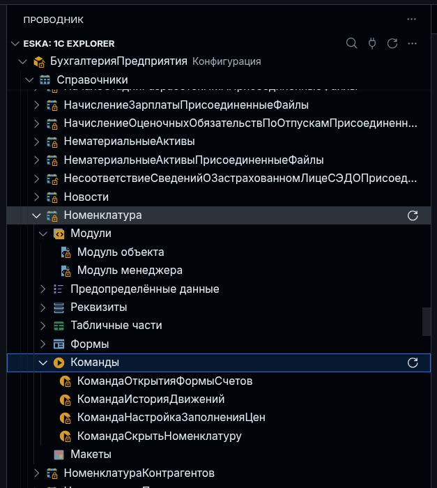
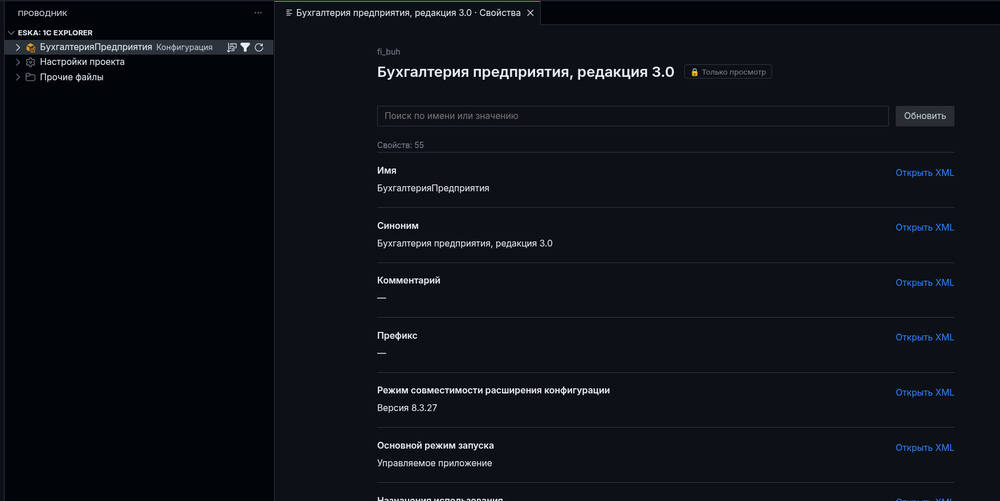

# Работа с ESKA и ESKA: 1C Explorer

Руководство по текущим исходникам. Оно охватывает
подготовку проекта Designer XML, редактор, BSL-анализ, Git и сборку файлов 1С.
Версия checkout указана в `Cargo.toml`; доступность готовых пакетов проверяется отдельно.

[Полная ESKA и мини-программы](#components) · [Установка](#installation) · [Первый проект](#project) ·
[Explorer](#explorer) · [Свойства](#properties) · [BSL](#language) ·
[Workspace](#workspace) · [CI](#check) · [Git](#daily-work) ·
[Сборка](#build) · [Обновление](#updates) · [Проблемы](#troubleshooting) ·
[Готовые сценарии](#scenarios)

<a id="components"></a>

## 1. Полная ESKA и мини-программы

У ESKA два способа запуска. **Общая команда `eska`** предоставляет единый вход:
`eska build`, `eska check`, `eska status`, `eska save` и другие команды.
**Мини-программы** запускают нужную часть напрямую: `eska-build`, `eska-check`,
`eska-vcs`, `eska-project`. Для обычной сборки подходят оба варианта:

```sh
# Через общую ESKA
eska build
```

```sh
# Напрямую через мини-программу
eska-build build
```

Это альтернативные вызовы: выполнять оба подряд для одной сборки не нужно.
Они используют один сборщик, один `eska.toml` и те же XML/BSL. Переносить проект,
конвертировать исходники или заводить второй конфиг при смене способа запуска
не требуется. У `eska-build` запуск без подкоманды тоже выполняет сборку;
в инструкции используется явное `eska-build build`, чтобы было видно действие.

### Что означает полный комплект

Полный комплект — `eska` и четыре исполняемых компонента. Оболочка выбирает
владельца операции и запускает его отдельным процессом. Поэтому установка
одного crate `eska` через Cargo не устанавливает остальные executable:
для `eska build` нужен `eska-build`, для `eska check` — `eska-check`,
для `eska status` — `eska-vcs`. Нужный комплект устанавливается в разделе ниже.

Мини-программы можно использовать без оболочки. Это удобно, когда на рабочей
машине нужен только Explorer, в CI — только проверка, а на сборочном агенте —
только выпуск файлов 1С. Платформа, анализатор, Git и расширение редактора
устанавливаются по потребности; сам полный CLI их не заменяет.

### Какой набор выбрать

| Задача | Достаточный набор |
| --- | --- |
| Открыть метаданные и редактировать существующие свойства | `eska-project` и Explorer |
| Получить подсказки и диагностики BSL в редакторе | Предыдущий набор и внешний `bsl-analyzer-app` |
| Проверить проект в CI | `eska-check` и `bsl-analyzer-app` |
| Собрать или распаковать CF/CFE/EPF/ERF | `eska-build` и платформа 1С с `ibcmd` |
| Вести задачи и сохранять commits | `eska-vcs`; для записи и transport нужен Git |
| Пользоваться общими командами `eska …` | Оболочка `eska` и компоненты нужных операций |

Для дерева платформа, Git, анализатор и оболочка не обязательны.
Команды `import` и `patch` дополнительно используют VCS-компонент.
Общий `eska build --manifest` также требует `eska-vcs` для сведений о Git;
прямой `eska-build build --manifest` работает без него и отмечает Git
в паспорте как `unavailable`.
`eska-project` не является языковым сервером: он передаёт контекст и метаданные,
а диагностики BSL вычисляет отдельный upstream-процесс. Текущая интеграция
принимает `bsl-analyzer-app` **0.3.2**, CLI contract **3.4**.

Исходники — выгрузка **Designer XML**: XML-дескрипторы, `.bsl` и ресурсы.
XML и BSL редактируются непосредственно; промежуточный формат ESKA не нужен.
После изменения в Конфигураторе выгрузите исходники заново самостоятельно.

### Соответствие существующих команд

В таблицах перечислен публичный CLI текущего checkout. **Совпадение пока
не полное**: у мини-программ есть команды без входа через `eska`.
Отсутствующие входы общего CLI не следует считать реализованными.

| Задача | Через `eska` | Прямой запуск | Особенности |
| --- | --- | --- | --- |
| Базовая проверка проекта | `eska` без подкоманды | `eska-project validate` или `eska-project` | У явного `validate` есть JSON и selectors; это не полная проверка BSL |
| Создать каркас | `eska new NAME --type TYPE` | `eska-project new NAME --type TYPE` | Различаются настройка платформы и Git; см. ниже |
| Подключить выгрузку | `eska init --source src` | `eska-project init --source src` | Общий вход — составная операция; прямой — структурная |
| Прочитать контекст приложения | Нет отдельной команды | `eska-project context` | Поддерживает `--application` и `--format json` |
| Управлять конфигом анализатора | Нет отдельной команды | `eska-project analyzer-config status/prepare/migrate` | Это подкоманды проектного компонента |
| Метаданные | `eska metadata …` | `eska-project metadata …` | Общие подкоманды `inspect`, `types`, `choices`, `check`, `apply`, `rename-preview`, `rename-apply`, `rename-recovery` |
| Версия проекта 1С | `eska version`, `eska version bump patch` | `eska-project version`, `eska-project version bump patch` | Чтение версии XML и увеличение `major/minor/patch` |
| Диагностика окружения | `eska doctor` | `eska-project doctor` | Project собирает в том числе проверки build/VCS; отсутствие компонента отражается в отчёте |
| Сервер для Explorer | `eska ide --stdio` | `eska-project serve --stdio` | Первый — legacy-вход; текущий backend Explorer использует второй |
| Полная проверка XML/BSL | `eska check …` | `eska-check …` | Аргументы одинаковы; у мини-программы нет дополнительного слова `check` |
| Сборка | `eska build …` | `eska-build build …` | Одинаковый native pipeline; различие Git-данных паспорта описано ниже |
| Распаковка в новый каталог | Нет `eska unpack` | `eska-build unpack INPUT DESTINATION` | Не создаёт манифест и Git |
| Новый проект из файла 1С | `eska new NAME --from FILE` | `eska-build unpack`, затем `eska-project init` | Это разные последовательности: прямой вариант не настраивает Git-workflow |
| Замена source из файла 1С | `eska import FILE` | `eska-build import FILE` | Нужен `eska-vcs`; сначала используйте `--dry-run` |
| Патч-расширение | `eska patch …` | `eska-build patch …` | Ограниченный сценарий committed-изменений общих модулей; VCS нужен и для плана |
| Очистка служебной ИБ | `eska clean` | `eska-build clean` | Опубликованные файлы сборки сохраняются |
| Поиск платформы | `eska platform list` | `eska-build platform list` | Показывает доступные установки |
| Машинные настройки | `eska config init`, `eska config edit` | `eska-build config init`, `eska-build config edit` | Настройки runner и путей для этой машины |
| Обновление CLI | `eska update --check`, `eska update` | Одноимённых команд у мини-программ нет | Используется поддерживаемый опубликованный канал; Cargo/checkout обновляются своим способом |

Все публичные Git-команды доступны через оба входа:

| Действие | Через `eska` | Через `eska-vcs` |
| --- | --- | --- |
| Клонировать проект | `eska clone URL DIRECTORY` | `eska-vcs clone URL DIRECTORY` |
| Состояние проекта | `eska status` | `eska-vcs status` |
| Изменения файлов или объектов | `eska diff`, `eska diff --semantic` | `eska-vcs diff`, `eska-vcs diff --semantic` |
| История | `eska history --limit 10` | `eska-vcs history --limit 10` |
| Начать задачу | `eska start TASK-123` | `eska-vcs start TASK-123` |
| Переключить задачу | `eska switch TASK-123`, `eska switch --base` | `eska-vcs switch TASK-123`, `eska-vcs switch --base` |
| Сохранить commit | `eska save -m "Сообщение"` | `eska-vcs save -m "Сообщение"` |
| Завершить локальную задачу | `eska finish` | `eska-vcs finish` |
| Отложить незавершённые изменения | `eska shelve` | `eska-vcs shelve` |
| Показать полки | `eska shelves` | `eska-vcs shelves` |
| Восстановить полку | `eska unshelve` | `eska-vcs unshelve` |

### Где нельзя просто заменить имя программы

`eska new/init` выбирают платформу, настраивают workflow и при необходимости
инициализируют Git. У них есть `--workflow`, `--no-vcs` и параметры выбора
платформы. `eska new --from` дополнительно распаковывает бинарный файл 1С.
Это операции для полного рабочего цикла, которым нужны project/build,
а без `--no-vcs` — также VCS.

`eska-project new/init` создают структуру проекта без поиска установленной
платформы и без Git-инициализации. У них нет `--workflow`, `--no-vcs` и `--from`.
Если передать `--platform-version`, значение записывается в манифест;
само наличие платформы этим не проверяется. `new` не генерирует XML объекта 1С.

`eska build --manifest` запрашивает Git-сведения у `eska-vcs` и включает их
в паспорт. `eska-build build --manifest` самостоятельно к Git не обращается;
`source.git.status = "unavailable"` означает отсутствие полученных сведений,
а не доказанное отсутствие repository. Исходники и проверка результата сборки
используют общий механизм у обоих входов.

`eska check --format json` соответствует `eska-check --format json`.
Запись `eska-check check` ошибочна. У `eska-build` действие, наоборот,
сохраняется: `eska-build build`, `eska-build clean`, `eska-build platform list`.

В текущем общем CLI нет `eska validate`, `eska context`, `eska analyzer-config`,
`eska serve` и `eska unpack`. Используйте соответствующий прямой вход из таблицы.
Для обычной проверки корня у общей программы есть запуск `eska` без подкоманды;
для подключения текущего Explorer — `eska-project serve --stdio`.

### Как читать и запускать примеры

В разделах сборки, анализа и Git сначала показана общая `eska`, затем прямой
вариант. Выбирайте один вариант для каждого действия. Можно смешивать входы:
например, подготовить контекст через `eska-project`, а проверять и собирать
через `eska check` и `eska build`.

Команды над существующим проектом запускаются из каталога с `eska.toml`
или с глобальным `--project-dir`. Его аргумент — каталог, не путь к манифесту:

```sh
eska --project-dir ./accounting build --dry-run
eska-build --project-dir ./accounting build --dry-run
eska-project --project-dir ./accounting context --format json
```

Для workspace `--project-dir` задаёт корень поиска, `--project NAME` выбирает
участника для поддерживающей этот флаг команды, а `--application NAME`
выбирает контекст анализа. Это разные параметры. `eska check` использует
`--application`, но не `--project` и не `--workspace`.

Имена каталогов, `TASK-123`, пути `/path/to/…` и версия платформы
`8.3.27.2325` в примерах заменяются вашими значениями. Флаги `--dry-run`
есть только у конкретных операций: их наличие проверяется в справке.

```sh
eska --help
eska build --help
eska-project --help
eska-build build --help
eska-check --help
eska-vcs --help
```

`--version` показывает версию программы; `version` без двух дефисов читает
версию проекта 1С. `--lang ru|en` меняет human-вывод, машинные JSON keys
не локализуются.

<a id="installation"></a>

## 2. Установите текущую сборку

### Публичный пакет и текущий checkout

Компонентная поставка появилась в ESKA `0.15.0`; для готовых бинарников проверяйте
Assets выбранного [GitHub Release](https://github.com/1c-tooling/eska/releases).
Все пять компонентов также доступны в Cargo registry.
Установите их через Cargo либо соберите checkout, а Explorer упакуйте из текущих
исходников: новый backend со старым VSIX сам по себе не добавит новый клиент.
Номер расширения в checkout пока также `0.0.12`, поэтому проверяйте происхождение
VSIX, выбранный путь backend и его возможности, а не только номер пакета.

### Полный комплект через Cargo

С установленным Rust/Cargo можно установить весь текущий набор:

```sh
cargo install --locked eska-project eska-check eska-build eska-vcs eska
```

Cargo собирает бинарник из опубликованного crate. Его каталог `bin` должен быть
в PATH редактора; либо задайте полный путь к установленному executable.
BSL Analyzer и VSIX устанавливаются отдельно.

После установки проверьте все пять программ:

```sh
eska --version
eska-project --version
eska-build --version
eska-check --version
eska-vcs --version
```

Такой комплект позволяет использовать общие команды и вызывать мини-программы
напрямую. Для воспроизводимой установки закрепите совместимые версии пакетов
из одного выпуска через синтаксис Cargo `имя-пакета@версия`.
`eska --help` проверяет только доступность оболочки: это ещё не проверка
платформы, анализатора или компонентов выбранной операции.

### Выборочная установка мини-программ

Если общий вход не нужен, установите только программы своего сценария.
Каждая строка ниже — самостоятельный вариант установки:

```sh
# Дерево и свойства в Explorer
cargo install --locked eska-project

# Только статическая проверка; app-анализатор устанавливается отдельно
cargo install --locked eska-check

# Только сборка или распаковка; платформа устанавливается отдельно
cargo install --locked eska-build

# Только Git-workflow для уже подготовленного проекта
cargo install --locked eska-vcs
```

Для подготовки XML из бинарного файла и последующего подключения Explorer
нужны `eska-build` и `eska-project`. Для `import` или `patch` — `eska-build`
и `eska-vcs`. Для одной общей команды можно поставить оболочку и её владельца:

```sh
# Минимальный набор для eska check
cargo install --locked eska eska-check
```

Он не обеспечивает `eska build` или `eska status`: их компоненты добавляются
отдельно. Внешний анализатор всё равно нужен для самой проверки.

### ESKA из checkout

Нужны Git для получения репозитория и Rust с Cargo. Версия toolchain закреплена
в `rust-toolchain.toml` — сейчас `1.99.1`. Существующий checkout можно использовать
вместо повторного клонирования; сначала сохраните собственные изменения.

```sh
git clone https://github.com/1c-tooling/eska.git
cd eska
cargo build --workspace --bins --release --locked
export PATH="$PWD/target/release:$PATH"
eska-project --version
eska-build --version
eska-vcs --version
eska-check --version
eska --version
```

Бинарники находятся в `target/release/`. `export` действует только в текущем
терминале; для GUI надёжнее явно указать абсолютные пути в настройках Explorer.
Для одного дерева достаточно собрать `cargo build -p eska-project --release --locked`.
Сама установленная Rust-программа не требует Cargo для работы.

Аналогично собираются отдельные `eska-check`, `eska-build` и `eska-vcs` через
`cargo build -p <имя-пакета> --release --locked`. Для полного комплекта используйте
приведённую выше сборку workspace: сборка только `-p eska` не выпускает остальные
исполняемые компоненты.

В PowerShell сборка та же; вместо `export` добавьте каталог в текущую сессию:

```powershell
$env:Path = "$(Join-Path (Get-Location) 'target/release');$env:Path"
eska-project --version
```

В Windows имена бинарников заканчиваются на `.exe`.

### Как общая ESKA находит мини-программы

Для каждого владельца можно задать явный путь в `ESKA_PROJECT_BINARY`,
`ESKA_BUILD_BINARY`, `ESKA_CHECK_BINARY` или `ESKA_VCS_BINARY`. Если override
задан неверно, команда сообщает ошибку, а не выбирает другой бинарник.
Без override поиск идёт рядом с запущенным executable, затем в PATH,
затем в `~/.eska/bin` (`USERPROFILE` в Windows).

Поэтому бинарники из одной сборки удобно хранить вместе. При нескольких
установках старая мини-программа рядом с `eska` может выбираться раньше новой
из PATH. Проверяйте не только номер оболочки, но и пути компонентов.
Для разового явного выбора на Linux/macOS:

```sh
ESKA_BUILD_BINARY=/path/to/eska-build eska build --dry-run
```

Путь замените существующим. Эта переменная выбирает компонент ESKA;
путь к платформенному `ibcmd` задаётся отдельно через параметры сборки.
Настройка `eska.explorer.executable` в режиме `project` также указывает
именно на `eska-project`, даже если в терминале вы пользуетесь полной `eska`.

### BSL Analyzer

Возьмите **app-бинарник** `bsl-analyzer-app` из
[официального релиза 0.3.2](https://github.com/itrous/bsl-analyzer/releases/tag/v0.3.2)
для своей ОС. В Assets есть Linux amd64, macOS arm64 и Windows amd64;
наличие ESKA для другой архитектуры не означает наличие такого app asset.
На Linux/macOS разрешите выполнение скачанного файла и укажите его абсолютный
путь в `eska.explorer.analyzerExecutable`. Полный ESKA-комплект анализатор не включает.

В Explorer команда **Подготовить проектный и языковой компоненты** проверяет
project и анализатор отдельно и предлагает установку доступного пакета.
При отсутствии project ZIP используйте локальную сборку; переход на монолит
не выполняется автоматически. Для CI путь передаётся через `--analyzer`
или переменную `ESKA_BSL_ANALYZER`.

### Explorer из исходников

Нужны VS Code/VSCodium **1.109.0 или новее** и Bun для упаковки checkout.
Из родительского каталога, в котором лежит `eska`:

```sh
git clone https://github.com/1c-tooling/eska-vscode-explorer.git
cd eska-vscode-explorer
bun install --frozen-lockfile --ignore-scripts
bun run package
```

Установите полученный `eska-explorer-<version>.vsix` через
**Расширения → … → Установить из VSIX…**. Если пакет с тем же номером уже
установлен, подтвердите замену и перезагрузите окно редактора.
Альтернатива для текущей версии checkout:

```sh
codium --install-extension ./eska-explorer-0.0.12.vsix --force
```

Для Microsoft VS Code замените `codium` на `code`. Версию имени файла берите
из результата упаковки. В установленном VSIX Bun и `node_modules` не нужны.

В пользовательских настройках редактора задайте реальные абсолютные пути
(в Windows используйте `.exe` и корректное JSON-экранирование обратных слешей):

```json
{
  "eska.explorer.backend": "project",
  "eska.explorer.executable": "/path/to/eska/target/release/eska-project",
  "eska.explorer.analyzerExecutable": "/path/to/bsl-analyzer-app",
  "eska.explorer.languageFeatures": true,
  "eska.explorer.supportPolicy": true,
  "eska.explorer.treeLanguage": "ru-RU"
}
```

Пути в примере — шаблоны: замените их перед использованием. Исполняемый файл
указывается без аргументов. `serve --stdio` добавляет сам Explorer.
В SSH/WSL/контейнере бинарники и пути относятся к машине проекта.
Для явного прежнего backend существует `backend = "legacy"` и executable `eska`;
это отдельный режим с меткой Legacy, не запасной вариант при ошибке project.

<a id="project"></a>

## 3. Подключите Designer XML

### Если выгрузка уже существует

Пусть файлы лежат так:

```text
accounting/
└── src/
    ├── Configuration.xml
    ├── Catalogs/
    ├── CommonModules/
    └── …
```

Для подключения без платформы и Git из `accounting/` выполните:

```sh
eska-project init --source src
eska-project validate
eska-project context --format json
```

Первый вызов создаёт `eska.toml`, определяет тип по XML и не инициализирует Git.
Исходные XML/BSL/ресурсы сохраняются. Если манифест уже есть, повторный `init`
не нужен. Для выгрузки в корне используйте `--source .`.
Нестандартный source задавайте явно; путь должен оставаться внутри проекта.

Минимальный манифест конфигурации:

```toml
[project]
type = "configuration"
source = "src"
```

Типы: `configuration`, `extension`, `processing`, `report`.
`validate` проверяет манифесты и корневые дескрипторы, а не весь BSL.
`context` показывает реально выбранные источники и платформу анализа.
У отдельного расширения, EPF или ERF без основной конфигурации контекст
ограниченный (`limited_context`): функции базовой конфигурации могут не разрешаться.

Если нужен полный цикл с Git и платформой, **вместо** структурного `init`
используйте общий вход для той же ещё не подключённой выгрузки:

```sh
eska init --source src --workflow trunk --platform-version 8.3.27.2325
eska
eska status
```

Это требует project/build/VCS-компонентов и подходящей платформы.
`eska` без подкоманды проверяет проект; полный анализ запускается отдельно
через `eska check`. Два варианта `init` не выполняются последовательно:
оба создают манифест, но выбирают разный объём настройки.

### Если есть только CF/CFE/EPF/ERF

Сначала установите платформу с `ibcmd` и узнайте точную версию.
Для нового проекта с Git используйте полную ESKA:

```sh
eska platform list
eska new processor --from import.epf --workflow trunk --platform-version 8.3.27.2325
```

Результат — каталог `processor` с исходниками, манифестом и Git-настройкой.
Дальше работайте из него. Для распаковки и подключения без Git используйте
другой вариант, через мини-программы:

```sh
eska-build platform list
eska-build unpack import.epf import-xml --platform-version 8.3.27.2325
eska-project init import-xml --source .
```

Замените версию на установленную. `import-xml` должен быть **новым каталогом**
с существующим родителем; даже пустой существующий каталог не заменяется.
CF загружается во временную служебную ИБ, CFE/EPF/ERF распаковываются платформой.
Рабочая база при этом не используется. `unpack` публикует только XML, а `init`
подключает его как проект.

Для каркаса без исходников: `eska-project new my-report --type report`.
Перед анализом и сборкой поместите в source настоящую выгрузку: команда не
генерирует объект 1С. Создание проекта с Git описано в разделе работы над задачей.

<a id="explorer"></a>

## 4. Откройте проект в Explorer

Откройте в редакторе папку, содержащую `eska.toml`, и предоставьте ей доверие.
В проводнике раскройте **ESKA: 1C Explorer**. При необходимости вызовите
**ESKA Explorer: Перезапустить подключение** из палитры команд.
Расширение не создаёт проект автоматически.


*Корень конфигурации: модули, общие объекты и разделы метаданных. Справа у корня — сортировка, фильтр пустых групп и обновление.*

Ветки подгружаются при раскрытии. «Модули» находятся первыми. Настройки проекта,
README и прочие файлы доступны в отдельных файловых группах; пустые файловые
группы не показываются. Из нескольких независимых папок редактора выбирается
один корень Explorer; внутри workspace ESKA видны его участники.



*Объект раскрывается на модули, предопределённые данные, реквизиты, табличные части, формы, команды и макеты. Маркеры замка относятся к поддержке 1С.*

Нажатие на модуль открывает BSL. Объект с группой «Модули» открывает свойства;
общий модуль и команда открывают свой код, если BSL существует.
У формы узел «Форма» открывает XML содержимого, узел «Модуль» — BSL;
нажатие на имя формы открывает её свойства. Визуального редактора форм нет.
**Открыть XML** в контекстном меню ведёт к описанию объекта.

Лупа ищет по имени и синониму, включая ещё не раскрытые ветки. Первое построение
поискового индекса идёт в фоне; до завершения выдача может быть частичной.
Сортировка и фильтр сохраняются отдельно для проекта. Фильтр скрывает пустые
разделы корня и разделы внутри «Общие», но не внутренние группы объектов.

| Действие | Windows/Linux | macOS |
| --- | --- | --- |
| Найти открытый файл в дереве | `Ctrl+K`, затем `E` | `Cmd+K`, затем `E` |
| Поиск метаданных | `Ctrl+K`, затем `F` | `Cmd+K`, затем `F` |
| Обновить дерево с фокусом в нём | `F5` | `F5` |

Сочетания действуют в контексте подключённого проекта/дерева. Git-цвета берутся
из встроенного Git редактора: они отражают сохранённые изменения файлов,
а не состояние отдельного поля или несохранённого буфера.

<a id="properties"></a>

## 5. Просматривайте и изменяйте свойства

Нажмите на объект или выберите **Свойства** в контекстном меню.
У каждого объекта своя вкладка. Поиск находит подписи, XML-имена, значения
и вложенные поля; **Открыть XML** выделяет свойство в исходнике.
Ссылки на поддержанные объекты ведут к их свойствам.



*Свойства конфигурации открыты для чтения. Поиск фильтрует поля, ссылки справа показывают соответствующий XML.*

Вкладка сначала заблокирована. Замочек разрешает изменение поддержанных полей
только этой вкладки; это не глобальное снятие правил поддержки 1С.
Текст сохраняется при выходе из поля или Enter, Esc отменяет текущий ввод.
Флажки и выбор из списка сохраняются сразу. Сохранённые изменения отменяются
кнопками истории и `Ctrl+Z` / `Ctrl+Shift+Z` (`Cmd` на macOS).

Редактируются существующие значения, для которых backend публикует схему:
тексты и локализованные строки, флаги, числа с границами, перечисления,
поддержанные ссылки, типы, параметры выбора и связанные параметры нумерации.
Недоступное поле объясняет причину или нужное условие. UUID, неизвестные поля
и неподдержанные структуры остаются для чтения; добавление/удаление элементов
коллекций, языков и типов не предоставляется.

Для имени используйте **Переименовать**: сначала введите новое имя, затем
просмотрите подтверждённые XML/BSL-замены, перемещения и сомнительные вхождения.
Сомнительные места не меняются автоматически; их просмотр нужно подтвердить.
Изменение исходников после preview требует нового preview.
Перед переименованием сохраните все документы проекта.

Несохранённый XML в обычном редакторе блокирует запись из свойств.
Внешняя правка сохраняет черновик, но требует **Обновить** перед повторным
сохранением. Разрыв соединения не вызывает автоматический повтор записи.
Эти проверки выполняет project backend; BSL Analyzer для них не требуется.

### Поддержка 1С

Оранжевый маркер на иконке показывает запрет изменений, редактирование с
сохранением поддержки либо снятие с поддержки; подсказка поясняет состояние.
Запрещённый исходник открывается в защищённой вкладке `eska-protected:`.
Сессионная команда редактора «сделать доступным для записи» такой запрет не снимает.
Разрешённые собственные модули остаются обычными файлами.

По умолчанию `eska.explorer.supportPolicy = true`. Проверка выполняется по
правилам выгрузки и не заменяет правила доступа самой информационной базы.
При отключении снимаются ограничения ESKA; пользовательские ограничения редактора
сохраняются. Замочек свойств не обходит policy backend.

<a id="language"></a>

## 6. Включите BSL и подготовьте конфиг

Базовая подсветка BSL/SDBL входит в Explorer. Языковой сервер запускается при
первом открытии BSL либо вручную, не требует предварительного раскрытия дерева.
Он предоставляет диагностики несохранённого текста, hover, completion,
определения, ссылки, символы, семантическую подсветку и поддержанные операции
форматирования, rename и code actions. Отдельный `.sdbl` пока имеет только
базовую подсветку; редактор и конструктор запросов остаются в разработке.

`eska.toml` — первичный конфиг. Политика анализатора задаётся, например, так:

```toml
[tools.bsl-analyzer.diagnostics.parameters]
LineLength = false

[tools.bsl-analyzer.formatting]
use_tabs = true
indent_size = 1
```

ESKA выводит состав приложения и пути из манифестов и создаёт производный
`bsl-analyzer.toml`. Его не нужно править параллельно с `eska.toml`.
Для проверки из терминала, с настоящим путём к app:

```sh
eska-project analyzer-config status --format json
eska-project analyzer-config prepare --analyzer /path/to/bsl-analyzer-app
```

`status` ничего не записывает; exit 0 означает `current`, а ненулевой код
может означать ещё не созданный или устаревший конфиг. `prepare` проверяет
конфиг настоящим анализатором перед публикацией.

### Если уже есть собственный bsl-analyzer.toml

Сначала получите предварительный просмотр:

```sh
eska-project analyzer-config migrate --analyzer /path/to/bsl-analyzer-app --format json
```

Разберите несовпадения контекста и политики. После проверки примените
**актуальный** `preview_token` из ответа:

```sh
eska-project analyzer-config migrate --apply --preview-token TOKEN --analyzer /path/to/bsl-analyzer-app
```

Оригинал сохраняется в `bsl-analyzer.toml.eska-original-<hash>`.
Ручные изменения уже сгенерированного файла вызывают конфликт вместо перезаписи.

В строке состояния `ESKA v…` относится к project, а `BSL Analyzer v…` —
к выбранному app. Проверенный бинарник ещё не означает готовую модель языка.
При проблеме откройте Output и выполните **Перезапустить языковой сервер**.
`eska.explorer.languageFeatures = false` отключает свой LSP, сохраняя дерево
и базовую подсветку.

Если доступно расширение `elishevkirill.bsl-analyzer-lsp`, собственный клиент
Explorer приостанавливается. Отключите конфликтующее расширение для рабочей
области, если хотите использовать клиент Explorer. После отключения или
удаления он повторно проверит контекст и возобновится. Дерево продолжает работать.

<a id="workspace"></a>

## 7. Объедините конфигурацию, расширения и EPF в приложение

Workspace хранит несколько проектов в одном корне. Это явное перечисление
манифестов, а не автоматический поиск соседних каталогов.
Каждому member нужен свой `eska.toml` и уникальный `project.name`.

```text
solution/
├── eska.toml
└── src/
    ├── main/eska.toml
    ├── integration/eska.toml
    └── data-import/eska.toml
```

Пример корневого `eska.toml`:

```toml
[workspace]
members = ["src/main", "src/integration", "src/data-import"]

[build]
platform_version = "8.3.27.2325"
artifacts_directory = "build"

[analysis]
default_application = "accounting"

[applications.accounting]
configuration = "main"
extensions = ["integration"]
external_objects = ["data-import"]
```

В `src/main/eska.toml`, если XML лежит в том же каталоге:

```toml
[project]
name = "main"
type = "configuration"
source = "."
```

Остальным members задайте соответственно `name = "integration"`,
`type = "extension"` и `name = "data-import"`, `type = "processing"`.
Выбирайте `source` по фактическому расположению XML, без автоматического
добавления `/src`. При подключении существующих выгрузок `eska-project init`
из workspace обновляет список members; `new` создаёт участника в `src/<name>`.

```sh
eska-project validate --workspace
eska-project context --application accounting --format json
eska-project analyzer-config prepare --application accounting --analyzer /path/to/bsl-analyzer-app
```

Ссылки в `applications` — **имена members**, не имена XML и не пути.
Для зависимых расширений существует `extension_dependencies`.
Несколько независимых конфигураций не объединяются в один контекст.
Без `applications` один member даёт собственный контекст, несколько требуют
явного приложения. Соседняя конфигурация или БСП не подключается по совпадению
имён или версии; базу нужно включить в состав приложения явно.

**Выбрать контекст анализа** в палитре Explorer выбирает объявленное приложение.
Один корень использует один сгенерированный конфиг. Перед сменой контекста
остановите LSP во всех использующих его окнах и явно подготовьте другой:

```sh
eska-project analyzer-config prepare --application accounting --switch-context --analyzer /path/to/bsl-analyzer-app
```

<a id="check"></a>

## 8. Проверяйте проект локально и в CI

Через общую ESKA:

```sh
eska check --analyzer /path/to/bsl-analyzer-app --format json --report check-result.json
```

Через мини-программу, с теми же параметрами:

```sh
eska-check --analyzer /path/to/bsl-analyzer-app --format json --report check-result.json
```

Файл отчёта должен быть **новым**, вне source; его родительский каталог должен
существовать. При повторном запуске выберите новое имя или отдельно удалите
свой старый отчёт. Команда не перезаписывает существующий результат.
Пример с `check-result.json` рассчитан на `source = "src"`. Если source —
корень проекта (`"."`), задайте путь отчёта вне проекта, например
`/path/to/reports/check-result.json`, где `/path/to/reports` — существующий каталог.
Для приложения добавьте `--application accounting`.
Выберите один вызов: если выполнить оба с тем же `--report`, второй откажется
заменять уже созданный файл.

Проверка обходит объявленные XML и выполняет полный анализ BSL выбранного
контекста. Потерянный или оборванный ответ анализатора не считается успехом.
Сеть, Git, IDE и платформа 1С не требуются, если бинарник и контекст уже доступны.

Оба входа сами подготавливают принадлежащий ESKA `bsl-analyzer.toml` и проверяют
его анализатором. Для обычного CI-запуска executable `eska-project` не нужен.
Если требуется миграция пользовательского файла или смена активного контекста,
сначала выполните соответствующую команду `eska-project analyzer-config`:
проверка не принимает такие решения автоматически.

Пороги задаются в owning `eska.toml`:

```toml
[tools.eska-check]
max_errors = 0
max_warnings = 0
```

| Exit code | Что означает |
| --- | --- |
| `0` | Полная проверка завершена, пороги соблюдены |
| `1` | Полная проверка завершена, пороги превышены |
| `2` | Ошибка аргументов командной строки |
| `3` | Проверка не завершена: ошибка контекста, конфигурации, сервера или отчёта |
| `130` | Проверка отменена |

JSON и его ключи не зависят от `--lang ru|en`. Язык сообщений самого анализатора
задаётся его политикой. `validate`, полный статический анализ и компиляция
платформой — разные проверки; ни одна не подтверждает бизнес-поведение в базе.

<a id="daily-work"></a>

## 9. Ведите задачу в Git

Этот сценарий требует `eska-vcs`, а составные `new/init` — также оболочку,
project/build-компоненты. Для записи commits и transport установите Git,
задайте имя и email автора. Git LFS нужен, если его фильтры есть в `.gitattributes`.

Для существующей выгрузки `src` без манифеста:

```sh
eska init --workflow trunk --platform-version 8.3.27.2325
eska save -m "chore: Подключён проект ESKA"
```

Эта команда отличается от `eska-project init`: она выбирает workflow, проверяет
платформу и инициализирует Git при его отсутствии. Для существующего проекта
с манифестом не повторяйте `init`: проверьте его VCS-настройки и repository.

Составная команда из файла: `eska new processor --from processor.epf --workflow trunk --platform-version 8.3.27.2325`.
Без `--from` `eska new demo --type configuration --workflow trunk` создаёт
только каркас — source нужно заполнить настоящей выгрузкой.

| Workflow | Базовая ветка | Ветка задачи |
| --- | --- | --- |
| `trunk` | `main` | `task/<ID>` |
| `github-flow` | `main` | `feature/<ID>` |
| `git-flow` | `develop` | `feature/<ID>` |
| `custom` | Явная policy | Явная policy |

Начинайте задачу из чистого repository после первого commit:

```sh
eska start TASK-123
eska status
eska diff --semantic
eska save --dry-run
eska save -m "fix: Исправлен расчёт суммы"
```

Если проект и workflow уже подготовлены, те же действия доступны без оболочки:

```sh
eska-vcs start TASK-123
eska-vcs status
eska-vcs diff --semantic
eska-vcs save --dry-run
eska-vcs save -m "fix: Исправлен расчёт суммы"
```

У `eska-vcs` нет `new/init`: мини-программа работает с уже существующим
проектом и Git repository. Установка только VCS не создаёт исходники,
манифест и workflow. Для начала с нуля используйте составные команды выше
либо отдельно подготовьте структуру и VCS-настройки.

Изменяйте XML/BSL в редакторе либо выгружайте новые изменения из Конфигуратора,
затем проверяйте diff и анализ. Semantic diff сообщает поддержанные изменения
объектов/модулей; он не заменяет чтение diff или BSL-анализ.
`save` сохраняет локальный commit. Для незавершённых изменений предусмотрены
`eska shelve`, `eska shelves`, `eska unshelve`.

Ветку публикуйте и создавайте PR средствами вашего Git-сервиса.
После интеграции задачи `eska finish` проверяет вхождение текущего commit
в целевую историю, переключает на базовую ветку и удаляет локальную ветку задачи.
Он не выполняет merge, push и создание PR. После squash/rebase исходный commit
может не входить в историю, и стандартный finish откажет.

<a id="build"></a>

## 10. Собирайте и распаковывайте файлы 1С

### Подготовьте платформу и проект

Для `eska build` нужны оболочка и `eska-build`; для прямого `eska-build build`
достаточно сборщика. В обоих случаях необходимы Designer XML, `eska.toml`
и установленная платформа 1С с `ibcmd`. Explorer, BSL Analyzer и project-сервер
для обычной сборки не требуются.

В owning манифесте укажите **свою точную установленную** версию:

```toml
[build]
platform_version = "8.3.27.2325"
artifacts_directory = "build"
```

### Сборка через полную ESKA

Из каталога проекта сначала посмотрите платформы, затем план и результат:

```sh
eska platform list
eska build --dry-run
eska build
```

`platform list` показывает доступные установки. `--dry-run` выполняет preflight
и показывает план, но не создаёт файл сборки. Успех dry-run не равен успешной
компиляции: артефакт появляется после обычного `build`.

Для паспорта сборки используйте `eska build --manifest` вместо обычного build.
В этом варианте дополнительно нужен `eska-vcs`, даже если пользователь
не собирается выполнять Git-команды вручную.

### Сборка через мини-программу

Альтернативная последовательность для того же проекта:

```sh
eska-build platform list
eska-build build --dry-run
eska-build build
```

Здесь оболочка не нужна. Для паспорта используйте `eska-build build --manifest`.
Мини-программа не получает сведения о repository и записывает Git как
`unavailable`. Остальные правила сборки и проверки исходников общие.

### Результаты и параметры сборки

| Тип в манифесте | Результат |
| --- | --- |
| `configuration` | `.cf` |
| `extension` | `.cfe` |
| `processing` | `.epf` |
| `report` | `.erf` |

По умолчанию используется `build/`, если `artifacts_directory` не переопределён.
Точный путь к артефакту сообщает команда. `--manifest` собирает из фиксированного
снимка source и сохраняет машинный паспорт рядом с результатом.
У общей и прямой команды одинаковые основные параметры:

| Параметр | Когда использовать |
| --- | --- |
| `--dry-run` | Проверить готовность окружения и план до сборки |
| `--manifest` | Получить артефакт с паспортом; Git-сведения зависят от входа |
| `--output PATH` | Задать путь одного артефакта; должен быть выбран один проект |
| `--format json` | Получить машинный результат для скрипта |
| `--project NAME` | Собрать участника workspace; выбор можно повторять |
| `--workspace` | Собрать всех участников workspace |
| `--platform-version VERSION` | Выбрать версию платформы на этот запуск |
| `--ibcmd PATH` | Явно указать executable платформы |
| `--base-configuration FILE.cf` | Загрузить базовую конфигурацию для EPF/ERF |
| `--recreate-infobase` | Создать служебную ИБ заново вместо переиспользования |

Относительный `--output` считается от корня проекта или workspace.
Разовый `--platform-version` не переписывает значение в манифесте.
Полную справку показывают `eska build --help` и `eska-build build --help`.

### EPF/ERF с базовой конфигурацией

Если обработка или отчёт использует объекты базы, передайте актуальный CF:

```sh
eska build --base-configuration ../base.cf --recreate-infobase
```

Альтернатива через мини-программу:

```sh
eska-build build --base-configuration ../base.cf --recreate-infobase
```

При изменении базового CF пересоздайте служебную ИБ, чтобы сборка использовала
новую базу. Этот параметр относится к native-сборке. Контекст BSL Analyzer
задаётся отдельно через `applications` и исходники базовой конфигурации;
передача CF сборщику сама по себе не добавляет БСП или базу в анализатор.

### Выбор установки 1С и Distrobox

`ibcmd` должен соответствовать выбранной версии. При неоднозначности передайте
`--ibcmd /path/to/ibcmd`, `--platform-arch` или настройте машинный конфиг:

```sh
eska config init
eska config edit
```

Прямой вариант:

```sh
eska-build config init
eska-build config edit
```

Для платформы внутри Linux Distrobox в машинном конфиге задайте:

```toml
[build]
runner = "distrobox"
container = "1c-ubuntu-env"
platform_arch = "x86_64"
```

Контейнер и платформу подготовьте заранее. Для установки на основной системе
используйте `runner = "host"` или автоматический поиск; Distrobox не обязателен.

### Повторная сборка и очистка

Совместимая повторная сборка может переиспользовать управляемую служебную ИБ.
Чтобы удалить её, выполните один из вариантов:

```sh
eska clean
```

```sh
eska-build clean
```

Опубликованные артефакты и паспорта сохраняются. Следующая сборка подготовит
служебную ИБ снова. Это не удаление рабочей информационной базы пользователя.

### Распаковка, import и patch — разные действия

`eska-build unpack FILE NEW_DIRECTORY` выгружает файл в новый каталог.
У общего CLI нет подкоманды `unpack`. Если нужен сразу проект с манифестом
и Git, используйте `eska new NAME --from FILE`; для мини-программ —
`unpack`, затем `eska-project init` без Git.

Для обновления **существующего** source из файла сначала получите preview:

```sh
eska import updated.cf --dry-run
eska import updated.cf
```

Прямой вариант:

```sh
eska-build import updated.cf --dry-run
eska-build import updated.cf
```

После preview проверьте выбранный проект, файл и заменяемые пути, затем
подтвердите обычный вызов. Обоим вариантам нужен `eska-vcs` для preflight.
Import заменяет source, а не сливает произвольные XML. Тип файла должен
соответствовать проекту; для EPF используйте `.epf`, для расширения — `.cfe`.

`eska patch --dry-run` строит ограниченный план патч-расширения по committed
изменениям методов общих модулей. Для реального patch требуются VCS, `ibcmd`
и `1cv8` одной установки. Команда не является универсальной упаковкой любых
изменений; применимость и runtime-проверки описаны в отдельном patch-контракте.
Прямой вход — `eska-build patch`; те же ограничения действуют для него.
Реальный файл патча не создаётся при `--dry-run`.

<a id="version"></a>

## 11. Меняйте версию проекта, а не CLI

Через общую ESKA:

```sh
eska version
eska version bump patch
```

Или через проектный компонент:

```sh
eska-project version
eska-project version bump patch
```

Это версия из XML проекта 1С; `eska-project --version` показывает версию инструмента.
Выполняйте `bump` только один раз выбранным способом: два вызова увеличат версию
дважды. Кроме `patch` доступны `minor` и `major`. Универсальной команды `set`
и dry-run у `version bump` нет.
У workspace используйте selectors нужного участника. Изменение XML затем
проверяйте в diff и сохраняйте отдельно в Git.

<a id="updates"></a>

## 12. Обновление, работа без сети и удаление

Для опубликованной установки оболочки: `eska update --check`, затем
`eska update`. Для checkout обновите исходники выбранным вами Git-процессом,
пересоберите компоненты и заново упакуйте/установите VSIX.
Обновление только CLI не обновляет расширение и внешний анализатор.

Explorer показывает отдельные индикаторы project и Analyzer; нажатие проверяет
обновление соответствующего компонента. Установка требует отдельного действия.
Пользовательский бинарник по указанному пути не перезаписывается.
Управляемые компоненты используют receipts, проверки checksum и восстановление;
при незавершённой операции в палитре есть команды восстановления установки.

Для работы без сети заранее разместите совместимые бинарники и VSIX, задайте
абсолютные пути и отключите фоновые проверки:

```json
{
  "eska.explorer.checkForUpdates": false,
  "eska.explorer.checkForAnalyzerUpdates": false
}
```

Project, дерево и локальный анализ не требуют сети после подготовки компонентов.
Доступность ресурсов platform-help зависит от вашего конфига анализатора.

Расширение удаляется через раздел «Расширения» редактора.
Project и Analyzer удаляются отдельно от VSIX. Для компонентной установки
из локального bundle применяется его установщик с тем же root:

```sh
python3 BUNDLE/components.py status --component eska-project --root PREFIX --format json
python3 BUNDLE/components.py remove --component eska-project --root PREFIX
```

Замените `BUNDLE` и `PREFIX` своими путями. Другие управляемые компоненты
удаляйте отдельно по имени. Для собственной сборки уберите добавленный путь
из PATH и выбранные настройки executable; каталог сборки принадлежит вашему
checkout. При ручном удалении shell-установки уберите её PATH/env-строки
из профиля shell перед следующим запуском терминала.
Не оставляйте ссылку на удалённый `~/.eska/bin/env` в `.bashrc`/профиле.

<a id="troubleshooting"></a>

## 13. Если что-то не работает

| Симптом | Что проверить |
| --- | --- |
| Нет `eska-project` или project ZIP | Версию и Assets выбранного релиза; установите компонент через Cargo либо соберите checkout |
| Есть `eska`, но не найден компонент | Установите владельца: build/check/project/VCS. Один crate `eska` не устанавливает остальные executable |
| Не принимается `eska unpack/context/analyzer-config` | Этих входов пока нет в общем CLI; используйте `eska-build unpack` или соответствующую команду `eska-project` |
| Не принимается `eska-check check` | Уберите второе `check`: мини-программа сразу выполняет проверку |
| `eska-project init` не принимает `--workflow` | Это структурный вход; составная операция с Git — `eska init` |
| `eska build --manifest` требует VCS, а обычный build работает | Общий вход получает Git-сведения для паспорта; установите `eska-vcs` или используйте прямую сборку без этих сведений |
| После обновления PATH запускается старый компонент | Проверьте `ESKA_*_BINARY` и бинарники рядом с оболочкой: они имеют приоритет перед PATH |
| Не подключается дерево | Доверие папке, `eska.toml`, абсолютный executable, режим `project` и Metadata API 1.12 |
| Backend новый, UI старый | Перепакуйте и переустановите текущий VSIX; номер `0.0.12` может совпадать со старым релизом |
| Есть подсветка, но нет диагностики | Путь и версия app 0.3.2, `languageFeatures`, состояние LSP, Output и конфликт BSL-расширений |
| Нужна миграция конфига | Preview/apply через `eska-project analyzer-config migrate`; не перезаписывайте файл вручную |
| Не меняется приложение анализа | Остановите LSP во всех окнах этого root и выполните явный `--switch-context` |
| Свойства для чтения | Замочек, схема поля, зависимости, правила поддержки; неизвестные поля не редактируются |
| XML изменён снаружи или открыт с правками | Сохраните/разберите текстовый буфер, перечитайте свойства и повторите preview |
| Не находится функция БСП/базы | Реальная базовая выгрузка должна входить в выбранное приложение; проверьте `context` |
| `eska-check` вернул `3` | Проверка не завершена: читайте stderr/JSON `error`, не трактуйте как отсутствие диагностик |
| Сборка не находит платформу | Точная версия, `platform list`, `--ibcmd`, архитектура и runner host/Distrobox |
| Файл сборки есть, но бизнес-логика не проверена | Выполните отдельную проверку в целевой информационной базе |

Журнал подключения доступен через меню **… → Показать журнал подключения**
в заголовке дерева. Для языка используйте соответствующий канал Output.
`eska doctor` / `eska-project doctor` собирают диагностику окружения;
отсутствие необязательного компонента в таком отчёте не запрещает работу дерева.
При сообщении об ошибке укажите ОС, редактор, версии VSIX/project/app,
режим backend, выбранное приложение и воспроизводимые шаги.

Основная текущая приёмка — Linux/VSCodium и платформа 8.3.27.2325.
Windows, macOS, Microsoft VS Code и Remote остаются отдельными непроверенными
строками пользовательской матрицы. Браузерная IDE и виртуальные workspace
не поддерживаются. Встроенного отладчика и визуального редактора форм нет;
конструктор запросов ещё не следует считать готовой возможностью.

<a id="scenarios"></a>

## 14. Сценарии от начала до результата

Это самостоятельные маршруты. Выберите сценарий по исходным данным;
не выполняйте все блоки подряд в одном каталоге. Имена каталогов и файлов
условные, а команды выполняются после установки указанных компонентов.
Варианты «через ESKA» и «напрямую» показывают альтернативы одного действия.

| Исходная задача | Сценарий |
| --- | --- |
| Есть XML, нужны дерево и свойства без платформы | [1. Минимальное рабочее место](#scenario-editor) |
| Есть XML, нужен весь рабочий цикл с Git и сборкой | [2. Полная ESKA](#scenario-full) |
| Есть EPF/ERF, нужны исходники и обратная сборка | [3. Работа с бинарным файлом](#scenario-binary) |
| Нужен анализ в CI без редактора и платформы | [4. Проверка в CI](#scenario-ci) |
| Нужна только сборка на отдельной машине | [5. Сборочный агент](#scenario-builder) |
| Конфигурация, расширение и EPF лежат вместе | [6. Workspace и приложение](#scenario-workspace) |
| Нужно прервать задачу с незавершёнными правками | [7. Полка и переключение](#scenario-shelf) |
| Пришёл новый файл 1С для существующего проекта | [8. Обновление через import](#scenario-import) |
| Нужен патч по изменениям общего модуля | [9. Патч-расширение](#scenario-patch) |

<a id="scenario-editor"></a>

### Сценарий 1. Только Explorer и Designer XML

**Есть:** каталог `accounting/src` с `Configuration.xml` и остальной выгрузкой,
манифеста ещё нет. **Нужно:** открыть метаданные, модули и свойства.
**Компоненты:** `eska-project`, Explorer и редактор.

```sh
cd accounting
eska-project init --source src
eska-project validate
eska-project context --format json
```

Откройте `accounting` в VS Code/VSCodium, разрешите доверие и настройте
backend `project` с путём к `eska-project`. Дерево должно показать корень
конфигурации. Откройте объект и свойства, затем модуль из группы «Модули».
Работа с интерфейсом показана на [скриншотах Explorer](#explorer).

**Результат:** появился `eska.toml`, исходники остались Designer XML;
Git и платформа для этого маршрута не нужны. Для completion, переходов
и диагностики BSL добавьте app-анализатор [по разделу BSL](#language).
Если полный комплект уже установлен, используйте его `eska-project`:
оболочку для этого маршрута запускать необязательно.

<a id="scenario-full"></a>

### Сценарий 2. Полный цикл: XML → задача → проверка → сборка

**Есть:** выгрузка `accounting/src` без манифеста.
**Компоненты:** полный комплект ESKA, Git с настроенным автором,
`bsl-analyzer-app` и платформа 1С. Версия ниже — пример.

Подключите проект и создайте первый commit:

```sh
cd accounting
eska init --source src --workflow trunk --platform-version 8.3.27.2325
eska save -m "chore: Подключён проект ESKA"
eska start TASK-123
```

Откройте проект в Explorer и внесите изменение в BSL или доступное свойство.
Сохраните файлы редактора. Подготовьте конфиг анализатора, если он ещё не готов:

```sh
eska-project analyzer-config prepare --analyzer /path/to/bsl-analyzer-app
```

Эта команда пока доступна только через мини-программу, даже при полном комплекте.
Если уже существует пользовательский `bsl-analyzer.toml`, сначала выполните
описанную в разделе BSL миграцию. Затем проверьте и соберите проект:

```sh
eska status
eska diff --semantic
eska check --analyzer /path/to/bsl-analyzer-app
eska build --dry-run
eska build --manifest
eska save --dry-run
eska save -m "fix: Исправлен расчёт суммы"
```

Переходите к следующему шагу после успешного завершения предыдущего и разбора
результата. **Результат:** локальный commit, файл 1С и паспорт сборки.
Паспорт относится к снимку на момент build: в этой последовательности изменения
ещё не были закоммичены при сборке. Для артефакта, связанного с итоговым commit,
повторите `eska build --manifest` после сохранения.

Публикация ветки и PR выполняются отдельно. `eska finish` используйте после
интеграции задачи по правилам workflow; он не выполняет эту интеграцию сам.

<a id="scenario-binary"></a>

### Сценарий 3. Получить XML из EPF/ERF и собрать файл обратно

**Есть:** `processor.epf`. **Нужно:** изменить модуль и получить новый EPF.
Платформа с `ibcmd` нужна при обоих вариантах.

Через полный комплект создайте проект с Git:

```sh
eska new processor --from processor.epf --workflow trunk --platform-version 8.3.27.2325
cd processor
eska save -m "chore: Добавлены исходники обработки"
```

Альтернатива без оболочки и Git — `eska-build` и `eska-project`:

```sh
eska-build unpack processor.epf processor-xml --platform-version 8.3.27.2325
eska-project init processor-xml --source . --platform-version 8.3.27.2325
cd processor-xml
eska-project validate
```

Каталог назначения должен отсутствовать до `unpack`.
Во втором варианте XML находится непосредственно в `processor-xml`, поэтому
используется `--source .`. Не подставляйте `--source src` автоматически.

После редактирования и сохранения исходников выполните выбранный вариант:

```sh
# В проекте из полной ESKA
eska build --dry-run
eska build
```

```sh
# В проекте из мини-программ
eska-build build --dry-run
eska-build build
```

Если обработке нужна база, добавьте `--base-configuration ../base.cf`
и при смене базы `--recreate-infobase`, как в [разделе сборки](#build).
**Результат:** Designer XML в проекте и собранный EPF в каталоге артефактов;
входной `processor.epf` использовался как источник распаковки.
Для отчёта замените вход на `.erf`; тип определяется по фактическим метаданным.

<a id="scenario-ci"></a>

### Сценарий 4. Полная статическая проверка в CI

**Есть:** checkout проекта `accounting` с `eska.toml` и исходниками,
бинарник анализатора и существующий каталог отчётов вне source.
**Минимальный набор:** `eska-check` и `bsl-analyzer-app`. Project-сервер,
платформа 1С и редактор этому job не нужны.

```sh
eska-check --project-dir ./accounting --analyzer /path/to/bsl-analyzer-app --format json --report /path/to/reports/check-001.json
```

Если агент использует общий CLI, установите также `eska` и вызовите:

```sh
eska --project-dir ./accounting check --analyzer /path/to/bsl-analyzer-app --format json --report /path/to/reports/check-001.json
```

Выберите один вариант. Путь отчёта замените реальным; каждый запуск получает
новое имя либо работает в новом каталоге job. Для приложения добавьте
`--application accounting`. Пороги задайте в `[tools.eska-check]` манифеста.

Передайте exit code команды в статус CI: `0` — успех, `1` — превышены пороги,
`2` — неверный вызов, `3` — проверка не завершена, `130` — отмена.
**Результат:** JSON-отчёт и статус job. Наличие пустого списка диагностик
не означает успех, если анализ оборвался. Этот job проверяет XML/BSL,
а native-сборка выполняется отдельно при наличии платформы.

<a id="scenario-builder"></a>

### Сценарий 5. Отдельный сборочный агент

**Есть:** готовый проект `processor`, манифест с точной версией платформы
и установленный `ibcmd`. **Минимальный набор ESKA:** `eska-build`.

```sh
eska-build --project-dir ./processor build --dry-run --format json
eska-build --project-dir ./processor build --manifest --format json
```

Сначала разберите результат dry-run; затем выполните сборку.
**Результат:** артефакт и паспорт со значением Git `unavailable`.
Для сборки с Git-сведениями установите оболочку и VCS-компонент и используйте:

```sh
eska --project-dir ./processor build --manifest --format json
```

Агенту с обычным `eska build` без паспорта VCS не требуется.
Native-сборка работает без редактора, LSP и check-компонента.
Статический анализ не запускается автоматически вместе с `build`;
если он нужен, добавьте отдельный шаг `check` до сборки.

<a id="scenario-workspace"></a>

### Сценарий 6. Собрать расширение и проверить его вместе с базой

**Есть:** workspace из [раздела приложений](#workspace): участники `main`,
`integration`, `data-import` и приложение `accounting`.
**Нужно:** анализ с базовым контекстом, затем сборка только расширения.

Сначала убедитесь, что манифесты и приложение разрешаются:

```sh
eska-project validate --workspace
eska-project context --application accounting --format json
```

Через общую ESKA:

```sh
eska check --application accounting --analyzer /path/to/bsl-analyzer-app
eska build --project integration --dry-run
eska build --project integration --manifest
```

Или через мини-программы:

```sh
eska-check --application accounting --analyzer /path/to/bsl-analyzer-app
eska-build build --project integration --dry-run
eska-build build --project integration --manifest
```

**Результат:** проверен контекст приложения, собран `.cfe` выбранного member.
Git-сведения паспорта отличаются по описанным выше правилам.
Для сборки всех members вместо `--project integration` используйте
`--workspace`; для нескольких — повторите `--project`.
Выбор приложения для анализа не означает сборку всех его участников.

<a id="scenario-shelf"></a>

### Сценарий 7. Прервать задачу и вернуть незавершённые изменения

**Есть:** активная ветка задачи `TASK-123` с несохранёнными в commit правками.
Нужно временно перейти на базовую ветку. Для общей команды нужен `eska-vcs`;
при прямом запуске достаточно только VCS-компонента и Git.

```sh
eska shelve --dry-run
eska shelve
eska switch --base
```

Позже, когда работу на другой ветке завершили и разобрали её изменения:

```sh
eska switch TASK-123
eska shelves
eska unshelve --dry-run
eska unshelve
```

Прямой вариант использует `eska-vcs shelve`, `eska-vcs switch --base`,
`eska-vcs switch TASK-123`, `eska-vcs shelves` и `eska-vcs unshelve`
с теми же `--dry-run` перед действиями.

**Результат:** восстановлены состояние index, рабочие файлы и сохранённые
untracked-файлы полки. Полка относится к ветке и всему repository, включая
соседние workspace members; это не отдельная полка выбранного модуля.
При несовпадении базы или конфликте сначала разберите отказ, не удаляя полку.

<a id="scenario-import"></a>

### Сценарий 8. Обновить существующий проект из нового файла 1С

**Есть:** подключённый проект конфигурации и новый `../updated.cf`.
Сначала сохраните нужные изменения source и проверьте состояние repository.
Нужны build/VCS-компоненты и платформа; для общего входа — также оболочка.

```sh
eska status
eska import ../updated.cf --dry-run
```

После проверки плана выполните import и разберите полученный diff:

```sh
eska import ../updated.cf
eska status
eska diff --semantic
```

Альтернатива через мини-программы:

```sh
eska-vcs status
eska-build import ../updated.cf --dry-run
eska-build import ../updated.cf
eska-vcs diff --semantic
```

Обычный import требует просмотра и подтверждения. После него выполните
`eska check` / `eska-check`, при необходимости сборку и только затем
`eska save` / `eska-vcs save` с сообщением о конкретном обновлении.
**Результат:** заменены исходники существующего проекта; повторный `init`
не нужен. Если нужна независимая выгрузка для сравнения, используйте
`eska-build unpack` в новый каталог вместо import.

<a id="scenario-patch"></a>

### Сценарий 9. Проверить возможность патч-расширения

**Есть:** проект с Git-workflow, базовая ветка `main` и закоммиченные изменения
поддержанных методов общих модулей. Это ограниченный patch-сценарий;
изменение произвольного объекта не становится допустимым патчем автоматически.

Получите план одним из способов:

```sh
eska patch --base main --dry-run --format json
```

```sh
eska-build patch --base main --dry-run --format json
```

Для плана нужен VCS-компонент, но не установленная платформа.
Если план допустим, для реального выпуска потребуются совместимые `ibcmd`
и `1cv8` одной установки. Каталог `build` ниже должен существовать,
а файл назначения — быть новым:

```sh
eska patch --base main --output build/TASK-123.cfe
```

Прямой вариант — `eska-build patch --base main --output build/TASK-123.cfe`.
**Результат:** ограниченное патч-расширение по принятому плану. Runtime-поведение
в рабочей базе этим не подтверждается; условия применимости и проверок
описаны в [patch-контракте](roadmap/t42-patch-extension.md).

<a id="references"></a>

## Точные контракты

[Project CLI](project-cli.md) · [Metadata API](ide-protocol.md) ·
[Приложения](application-context.md) · [Конфиг и миграция](analyzer-configuration.md) ·
[CI](check-cli.md) · [Сборщик](build-tool.md) · [VCS](vcs-tool.md) ·
[Делегирование общей команды](component-delegation.md) ·
[Компонентная установка](component-installation.md) · [Обновление CLI](cli-update.md) ·
[Patch-контракт](roadmap/t42-patch-extension.md) ·
[Сборка и установка VSIX](https://github.com/1c-tooling/eska-vscode-explorer/blob/main/docs/packaging.md) ·
[Языковой клиент](https://github.com/1c-tooling/eska-vscode-explorer/blob/main/docs/language-service.md)
